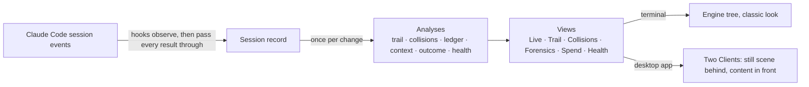

# Swarm Autopsy · Claude Mod

A live forensic pane for multi-agent Claude Code sessions. It shows:
- what each subagent was asked to do;
- what it observably did, and what its tokens were;
- how its report connects to the edits and tests that followed;
- where agents collided, and what is still unresolved.

Every claim carries an evidence label, so you can always tell what was **observed** from what was **inferred**.

In the Claude desktop app the pane is drawn over a **still, animated scene** that never moves while you scroll. There are
two categories of six scenes:
- **Spooky:** dark gray and a little haunted;
- **Cozy:** warm lamplight and golden hour.

Every scene has its own **lofi track** and **liquid-glass** cards whose transparency you choose. In the terminal it draws
a clean classic look.

> A community mod, not made by or affiliated with Anthropic.


<p align="center">
  
  
</p>

<p align="center"><i>The default side pane and the expanded pane. Five subagents of five different types (Explore,
general-purpose, a coder, a test engineer and a code reviewer) fixing a bug in a demo project, live.</i></p>

<p align="center">
  
  
  
  
</p>

<p align="center"><i>The same session over Rainy Forest Cabin, Hollow Library, Drowned Lighthouse and Mire Lights.</i></p>

## Why it's useful

When a session hands work to subagents, most of that work happens out of sight. The transcript shows each subagent's
final report, but not:
- its tool calls;
- its tokens;
- how its work met everyone else's.

Swarm Autopsy reads the session's own events as they happen and answers these questions, with evidence:

- **Who did what?**
  - which subagents ran, and who spawned each (the spawn's `tool_use_id` is the evidence);
  - what each was asked;
  - which files it read and wrote;
  - whether it completed, failed or was stopped.
- **Was the work checked?** For every changed file: did a test or check pass *after its last edit*, and which rule ties
  that check to the file? Files changed with no check after their final edit are flagged as unverified.
- **Did the test really pass?** A run counts as passed only when the tool reported success and nothing hid the exit
  status. A step after the check (`| tail`, `|| true`, `; echo`), a background `&`, a refusal or an interruption makes
  it *inconclusive*, never passed.
- **Did agents get in each other's way?**
  - two agents writing one file, in turn or interleaved;
  - one agent replacing text another wrote;
  - a write based on a read that another agent's edit had made stale;
  - an edit landing while another agent's test was running;
  - the same path changed in separate worktrees.
- **Was a report used?** Did a subagent's report reach a later delegation word for word, or were the files it named
  edited afterwards? Or does nothing captured show it being used?
- **Where did the tokens go?**
  - per agent and per spawn tree, by model;
  - with input, cache read, cache write and output kept apart;
  - and what share went to verified, unverified, failed, report-only or unresolved work.
- **How full did the context get?**
  - the main session's fill, as Claude Code reports it;
  - each subagent's estimate, with its assumption;
  - the peak prompt, and the compactions it heard.
- **What couldn't it see?** Activity before it loaded, events past its cap, and requests that came back with no usage.

**When it helps:**
- **While a swarm runs,** to catch a collision or a failing check early.
- **After it ends,** to review what each agent contributed before you trust the result.
- **When tuning a workflow,** to see which agents spend the most, and for what outcome.

## Install

At the prompt of a Claude Code terminal session:

```text
/plugin install swarm-autopsy --marketplace agryu-in/swarm-autopsy-claude-mod
```

Answer `y` to add the marketplace, then press Enter to choose the user scope, so the mod is installed for every project.

From a shell:

```bash
claude plugin install swarm-autopsy --marketplace agryu-in/swarm-autopsy-claude-mod
```

**In the Claude desktop app**, where `/plugin` does not run:
1. Click **+** next to the prompt box, then **Plugins**.
2. Choose **Add marketplace** and enter `agryu-in/swarm-autopsy-claude-mod`.
3. Choose **Add plugin**.

A mod installed from a terminal at the user scope loads in the desktop app's local sessions too. In a chat that was
already open, run `/reload-plugins`.

**Requirements:**
- Claude Code with mods (function hooks): 2.1.287 or later. Tested with Claude Code 2.1.301 (CLI) and 2.1.299 (the
  desktop app's engine). The mod API is early access and may change between releases.
- For the music: macOS, or Linux with PulseAudio or PipeWire (`paplay` and `pactl`). Without either, the pane simply
  says there is no audio player.
- `git` is optional: the Collisions view uses it to resolve worktree roots.

## Use it

| Command | What it does |
| --- | --- |
| `/swarm-autopsy` | Opens the pane: docked beside the transcript, or inline above the prompt in a non-fullscreen terminal |
| `/swarm-autopsy live` | Opens it on a view; also `trail`, `collisions`, `forensics`, `spend` or `health` |
| `/swarm-autopsy export` | Writes the collected session to a JSON file under the session's root and says where |
| `/swarm-autopsy close` | Closes the pane |

In the terminal, `1` to `6` switch views while the pane has the keyboard (`ctrl+x tab`, or a click). Tab walks the
buttons, and Esc hands the keys back. On the desktop, click the tabs.

## The views

| View | Shows |
| --- | --- |
| **Live** | The coordinating session, and one card per subagent: type, parent, task, state, last event, current tool, files, whether a report was captured, its own token usage (and its spawn tree's), and a context gauge. A card opens into its delegated prompt, files, report, context history, token ledger, spend-vs-outcome classification and event history. |
| **Trail** | Per agent, the chain from delegation to verification, and the edges between chains. Each edge carries its evidence and the rule that drew it. On the desktop, a map draws the same graph (solid = LINKED, dashed = INFERRED). |
| **Collisions** | A file × agent matrix (W written, r read, × failed edit), and signals: shared or interleaved writes, one agent replacing text another wrote, writes after a stale read, the same path changed in separate worktrees, edits during a running test, repeated failures, contradictory results. |
| **Forensics** | Every observed event in order, filterable (all / agents / files / tests / failures / signals) and by agent, paged, with the selected event's evidence: source hook, ids, paths, command, diff excerpt, result, and verdict basis. |
| **Spend** | The token ledger: per agent, its own requests (direct) and its whole spawn tree (subtree), with the four token categories kept apart, and session totals. A ≈$ API-equivalent estimate is shown only after you turn it on. Below it, *spend vs outcome*: each agent's tokens grouped by what its work amounted to (verified, changed but unverified, failed or inconclusive, report only, unresolved, mixed), with the denominator stated. |
| **Health** | The findings the other analyses already raised, grouped by source, each with its evidence label, its agents and its events. No score and no traffic light. |

## How each view works

Every view reads one session record and the analyses computed from it, once per change. The full rules, with every
threshold, are in the [technical reference](docs/TECHNICAL.md).

### Live

**What it shows:**
- **The coordinator** (the main session), then each subagent in order of first sight: full cards for the first 4 to 12
  (by the pane's height), then one line each.
- **Filters:** all, active, completed and failed.
- **A card** is built from the record:
  - the task: the spawn's description (or the agent list's), never invented;
  - the state: from how its turn ended (an answer is completed, aborted is stopped, anything else failed), and from
    Claude Code's agent list whenever the mod reads it;
  - its tokens and context gauge, from the ledger.
- **Pressing any line** of a card opens the inspector: under the card on a medium pane, in a detail column on a wide
  one, in place of the list on a compact one.
- **Recent activity** (the last 5 events) sits beside the cards on a wide pane. Every layout ends with a short Health
  strip.

**The context gauge:**
- **The main session.** Its % is Claude Code's own reading, OBSERVED.
- **A subagent.** Claude Code does not expose a subagent's window to mods, so its % is ESTIMATED: its latest prompt
  over the main session's window when both run the same model, otherwise over a dated table of documented windows.
- **An unknown model** shows UNAVAILABLE.

**Why it's useful:** you see at a glance who is working, on what, how close each agent is to its context limit, and
how much it has used.

### Trail

**The chain.** Each agent's work is a chain of five stages:
1. **delegation:** its prompt;
2. **investigation:** its reads, searches and read-only commands;
3. **finding:** its report;
4. **change:** each file it wrote successfully;
5. **verification:** its test and check runs.

**The edges.** Fixed rules join the chains:

| Edge | Drawn when | Label |
| --- | --- | --- |
| parent → delegation | the spawn record names the parent | LINKED |
| report → parent | the report came back to the agent's parent | LINKED |
| report → a later delegation | 12 or more words of the report appear verbatim in the later prompt | LINKED (fewer words: INFERRED) |
| report → a later delegation | the report and the later prompt name the same path | INFERRED |
| report → another agent's later change | the report names the changed file, and that agent could have received the report | INFERRED |
| delegation → the agent's own change | its prompt names the file it then edited | LINKED by path, INFERRED by file name |
| change → verification | a passed or failed test or check after the change names the file, was run by the same agent, or names no file and ran in the file's working tree | INFERRED |

**Matching:**
- Verbatim text is matched as runs of 7 or more words (and 40 or more characters).
- Text the author's own prompt already held is ignored, so a briefing the coordinator gave both agents is not taken for
  forwarding.
- Order alone never links anything.

**What stays open (UNRESOLVED):**
- An *unlinked contribution:* a report that reached nothing captured, from an agent that made no change and ran no
  check of its own.
- An *unverified change:* a change with no linked check after its last edit.
- A command whose latest run failed or was inconclusive.

**Why it's useful:** it shows whether each subagent's work led anywhere, and which edits were never checked after
their last change.

### Collisions

**The matrix.** Files × agents:
- `W` for writes, with a count;
- `r` for read only;
- `×` for only failed or refused edits.

It draws up to 24 files, most writers first, and counts the rest. On a narrow pane some agent columns are left out,
and it says how many.

**The signals** are decided by the session's own event order (no clock windows). Those to investigate are listed
before those to notice.

| Signal | Raised when | Label |
| --- | --- | --- |
| Shared write | two or more agents wrote the file. It is *interleaved* when the order returns to an agent (A → B → A) | OBSERVED |
| Overwrite | a later write replaced text a different agent wrote (a whole-file Write, or 12 or more characters of the same text) | OBSERVED / LINKED |
| Stale write | an agent wrote a file it had read, after another agent wrote it in between | INFERRED |
| Worktree divergence | the same relative path was written in two worktrees of one repository (found with `git rev-parse`) | OBSERVED |
| Test during change | another agent's write landed while a test or check was running | INFERRED |
| Repeated failure | a command errored twice or more in one directory, or two writes to one path errored | OBSERVED |
| Contradictory results | the same command in the same directory both passed and failed | OBSERVED |

**Why it's useful:** it finds agents that edited the same code, overwrote each other or tested against a moving
target. These are the usual reasons a swarm's result does not hold together.

### Forensics

**The timeline** is every recorded event in order (the latest 1,200), paged to the pane's height, newest page first.

**Filters:**
- **agents:** spawns, starts, stops, turn ends and compactions;
- **files:** reads, writes and searches;
- **tests:** test and check runs;
- **failures:** errors, denials, failed verdicts, and turns that did not end in an answer;
- **signals:** the events a collision signal rests on;
- an agent filter on top.

**The selected event's evidence:**
- the hook and ids it came from;
- its paths and access;
- the command and its kind;
- the diff excerpt and the result;
- the basis for the test verdict;
- the signals it is part of.

**Why it's useful:** any claim in another view can be traced back to the exact events it rests on.

### Spend

**How tokens are counted:**
- Usage is read from each model request as it completes, in four categories: input, cache read, cache write and
  output.
- A request is counted once; repeats are set aside and counted.
- **Direct** is an agent's own requests. **Subtree** adds its whole spawn tree.
- The session total adds every agent's direct total, so nothing is counted twice. Spawn-tree figures overlap and are
  never added.

**Spend vs outcome** puts each agent's tokens in one bucket:

| Bucket | When |
| --- | --- |
| verified | every change it made has a linked check that passed after the change's last edit, or its own passing check covers a linked change's final version |
| changed but unverified | a change has no linked check after its last edit |
| failed or inconclusive | a linked check after the last edit failed, or that command's latest run failed or was inconclusive, or the agent's own check ended that way |
| report only | a report, and no change or check |
| unresolved | nothing decides it (and tokens no agent can be tied to) |
| mixed | more than one of the above |
| coordinator | the main session's own tokens |
| no usage recorded | an agent with no request that reported usage |

The denominator is stated: the session's tokens processed.

**The ≈$ estimate:**
- It is off until you turn it on in Spend.
- It prices tokens at dated list prices built into the mod: API-equivalent, not a charge, and not what a subscription
  costs.
- A model without a price is named and left out, and the figure reads `≈$X+`.
- Usage does not say how long a cache write lasts, so the main loop's writes are priced as 1-hour and subagents' as
  5-minute.
- To use your own prices, point `SWARM_AUTOPSY_PRICES` at a JSON file ([format](docs/TECHNICAL.md#prices)).

**Why it's useful:**
- which agents spent the most;
- whether the cache did the work;
- what share of the session went to work that was checked.

### Health

**What it gathers.** The findings the other analyses already made, in six groups:
1. trail flags;
2. collision signals;
3. context;
4. the token ledger;
5. spend vs outcome;
6. coverage gaps (what the collector could not see).

Each finding keeps its source's label, its agents and its events. Health adds no score or threshold, and detects
nothing new except the coverage gaps.

**Why it's useful:** it is one list of what to look at. Each finding opens its evidence, and can take you to its agent
in Live or its step in Trail.

## The desktop look

**The toolbar** is a quiet glass bar fixed at the top of the pane:

| Control | What it does |
| --- | --- |
| **Mode** | The category: Spooky or Cozy |
| **Scene** | The scene within the category |
| **▶ Play / ⏸ Pause** and **Volume** ▁▃▅▇█ | The scene's lofi track |
| **Transparency** ◆◆◆◇◇ | How clear the liquid glass is, from frosted to crystal |

Your choices are kept for every chat. One chat plays the music at a time. When that chat closes, another takes over.

**The background** stays perfectly still while the content scrolls over it. It is drawn for the pane's own shape: a tall
side dock, a normal pane, or a wide one. A view too long for one drawing comes in **parts**, each scrolling smoothly over
the still scene. **Next part ▾** at the bottom of a part moves on.

**The scenes.** Each draws the main session's context fill as part of the picture, and one figure per active subagent:

| Mode | Scene | The context gauge | Each active subagent is |
| --- | --- | --- | --- |
| Spooky | Fogbound Cemetery | a lantern on the gate post, its oil lit | a crow on the fence |
| | Drowned Lighthouse | the lamp room filling with light | a gull |
| | Hollow Library | a candle burning down | a floating book |
| | Crooked Manor | the moon waxing | a bat |
| | Clocktower at Midnight | the clock face filling like a dial | a raven |
| | Mire Lights | a jar of gathered wisp light | a will-o'-wisp |
| Cozy | Rainy Cat Café | a latte filling to the brim | an umbrella passing in the rain |
| | Fireside Tea | the fire in the hearth, burning higher | a candle lit on the mantel |
| | Golden Hour Porch | a jar of honey on the porch rail | a swallow |
| | Sunset Pier | the pier's lanterns, lit one by one | a sailboat on the horizon |
| | Twilight Flower Shop | a glass vase filling as the bouquet opens | a butterfly |
| | Rainy Forest Cabin | a rain barrel by the door | a firefly |

**Colour.** Every colour that carries meaning follows the scene but keeps its meaning: verified stays green, a failure
red, caution warm. Each scene's palette is checked for 4.5:1 text contrast on its glass.

## All twelve scenes

Each scene draws the main session's context as part of the picture (here at 62%) and one figure per active subagent.


## Reading the evidence labels

| Label | Glyph | Meaning |
| --- | --- | --- |
| OBSERVED | ● | Reported directly by an event, message, command result or tool result. |
| LINKED | ◆ | Connected by explicit identifiers: a spawn's parent, `agentId` on the agent's own events, a verbatim excerpt of one agent's report in another's delegation prompt, a delegation prompt naming the exact path the agent then edited, or an edit replacing text another agent wrote. |
| INFERRED | ◇ | Plausible from indirect evidence: a shared path or file stem plus event order. A candidate, not proof. |
| UNRESOLVED | ? | Not enough evidence to decide: an *unlinked contribution*, an *unverified change*, a latest test run that failed. |
| UNAVAILABLE | ∅ | The interface does not expose it: a subagent's context %, the task of an agent spawned before the mod loaded. |

Numbers carry a simpler label:
- **OBSERVED ●:** read from an event.
- **ESTIMATED ≈:** computed from a stated assumption, such as a ≈$ figure, or a subagent's % on the same model as the
  main session.
- **UNAVAILABLE ∅:** not exposed or not yet captured.

## What it deliberately does not do

- **Model calls:** it never calls a model, so it cannot invent connections. Every link comes from a fixed rule over
  identifiers, paths and event order.
- **Value judgements:** it never calls a contribution "ignored", "unused" or "wasted". It can only say that no
  downstream evidence was captured.
- **Test results:** it never labels a test passed unless the tool's captured result says success.
- **Context %:** it shows one only where a window is known.
- **Your session:** it never blocks, delays or rewrites a tool call, spawn or prompt. Its hooks pass every result
  through unchanged.
- **Privacy:** it has no cloud service, network call or database. The session's record lives in the session and resets
  on `/clear`. Only your scene, music and glass choices are kept across sessions, in the mod's own store. `export`
  writes a file only when you ask.

## How it works

Swarm Autopsy is a Claude Code mod built on the function-hooks API. It is one TypeScript module,
`swarm-autopsy/hooks/register.tsx`, which Claude Code loads into the session. It has no build step, no npm
dependencies and no server.



### What it listens to

| Hook | What it gives the mod |
| --- | --- |
| `agent.spawn` | Who spawned whom, with the spawn's `tool_use_id`, the prompt, the description, the type and the new agent's id |
| `turn.start`, `turn.complete` | Each agent's turns, its report, and how each turn ended |
| `turn.step` | Each model request's usage, as it completes: the token ledger's only source |
| `tool.call` | Every tool call the engine raises, except Agent, Task and Workflow (so a subagent's own calls stay visible): paths, edits, commands and their results |
| `classic.SubagentStart`, `classic.SubagentStop` | Subagents starting and stopping, and their last message |
| `session.compact`, `session.measure` | Compactions; the main session's context reading and Claude Code's own cost figure |
| `session.start`, `session.end`, `command.run`, `ui.render`, `ui.message`, `ui.fault` | Setup and reset, `/swarm-autopsy`, and drawing the pane |

**Pass-through.**
- Every collecting hook records what it saw, then returns the engine's own result unchanged. Model responses stream
  through as they arrive.
- If the mod's own code fails, the event goes on untouched.
- Slower work runs on a 250 ms background tick, off the session's path: git lookups, refreshing the agent list, and
  routine writes of the record.

### The session record

**Where it lives.** In Claude Code's session state. It survives `/reload-plugins` and starts afresh on `/clear` or a
resume. It is written at most once a second.

**Caps.** They keep it small:

| What | Kept |
| --- | --- |
| Events | the latest 1,200 |
| Delegation prompts and reports | 2,000 characters each |
| Commands | 400 characters |
| Tool output | 600 characters |
| Edit excerpts | 1,200 characters per side |

**Analyses** are computed once per revision of the record, not on every redraw.

**Tool calls** are sorted by tool:
- **reads:** Read, NotebookRead, LSP;
- **writes:** Edit, Write, MultiEdit, NotebookEdit;
- **searches:** Glob, Grep, LS;
- **commands:** Bash, PowerShell.

**Tests and checks.** A command counts as a test or a check by the program at the head of one of its steps: `pytest`,
`jest`, `vitest`, `npm test`, `go test`, `cargo test`, `tsc`, `eslint`, `ruff`, `mypy`, `npm run lint`/`build` and so
on. Words inside a step don't count. [The full list](docs/TECHNICAL.md#tool-calls-tests-and-checks).

### Drawing the pane

- **The layout follows the width:** compact below 56 columns, medium, and wide from 100.
- **In the terminal,** it draws Claude Code's own element tree in a classic theme.
- **In the desktop app,** the pane is exactly the visible height. It is built from two Clients (surface modules) and the
  toolbar:
  - behind, one Client draws the still scene;
  - at the top, the toolbar stays fixed, drawn with the app's own controls;
  - in front, a second Client draws the header and the selected tab, scrolling in its own region.

  A press inside the content posts the button's key back to the hooks module, which runs that button's own handler.
- **Keeping within the page's limits:**
  - Every tree is mended to the desktop page's schema before it leaves, since one element the page refuses would blank
    the whole drawing.
  - A view past a Client's bounds (100,000 characters, 2,000 nodes) comes in parts.
  - If the app refuses a Client, the pane falls back to the engine tree with a note, then retries after 2, 6 and 20
    seconds.
- **Held while you browse.** A press holds the drawing's data for 20 seconds, so the line you are about to press doesn't
  move. **⏸ pause** holds it until you resume.
- **Every drawn string is cleaned:** colour escapes are removed, other control characters become spaces, and sizes
  are bounded. If a view still fails, the pane says which view and why, instead of going blank.

### Scenes and music

- **Scenes are SVG built in code.**
  - They are deterministic, seeded by the scene's id.
  - They are animated with SVG animation, so nothing redraws to move them.
  - They are rebuilt only when the pane's size, the context fill or the number of active subagents changes.
  - Each active subagent adds one figure, up to 9.
- **Colours** are computed in OKLCH. Tests hold every scene's text to 4.5:1 contrast on its glass.
- **Music:**
  - **Where PulseAudio's `paplay` works** (normally Linux): `paplay`, under its own client name, so a volume change
    through `pactl` touches only its stream.
  - **Otherwise, on macOS:** Claude Code's own audio player.
  - **One chat plays at a time.** The owner renews a heartbeat in the mod's store every 3 seconds. Another chat takes
    over 10 seconds after it stops.

### What it stores, reads, writes and runs

| Where | What |
| --- | --- |
| **Session state** | The session record and the pane's state (tab, filters, selection, the ≈$ switch) |
| **The mod's store** (kept across sessions) | `mood` (mode and scene), `glass` (transparency), `sound` (play and volume), `music-owner` |
| **Files written** | Only an export: `/swarm-autopsy export` writes `swarm-autopsy-export-<time>.json` in the session's root |
| **Files read** | Only the price file, if you set `SWARM_AUTOPSY_PRICES`. The music player plays the mod's own tracks from `music/` |
| **Processes run** | `git rev-parse` (worktree roots, for directories that were written); for music, `uname`, `pactl` and `paplay` |
| **Environment** | `SWARM_AUTOPSY_PRICES`: a JSON price table for ≈$. `SWARM_AUTOPSY_EXPORT`: a path to write the export to after each main turn and at the session's end |

An export is `{kind, exportedAt, note, snapshot, analysis}`: the full record and every analysis, with ≈$ always
included.

## Known limitations

- Activity before the mod loaded is not captured; the pane says so, and agents still running are adopted.
- Shell commands' file side effects are not attributed to paths. Only Edit, Write, MultiEdit and NotebookEdit count as
  writes.
- The timeline keeps the latest 1,200 events, and older ones are counted as dropped. Agent totals still include them;
  Trail, Collisions and Forensics cover the events kept.
- Path mentions in reports are read with a pattern, so a link from a shared file name is INFERRED, never proof.
- The desktop scenes use the desktop app's drawing surface. Other surfaces draw the classic look.
- Where an organization manages Claude Code, the `classic.SubagentStart`, `classic.SubagentStop` and `session.compact`
  hooks run only for plugins its managed settings list (as `claude plugin validate` reports). Installed by a person
  there, the mod still sees spawns, turns, usage and tool calls, but not subagent starts and stops or compactions.
- **Captured text is not redacted.** Captured prompts, reports, commands and output excerpts are kept in session state,
  which Claude Code lets any mod in the session read. An export writes them as they are, so treat an export like a
  transcript.
- **A subagent's context % is an estimate:** Claude Code does not expose a subagent's window to mods. It is UNAVAILABLE
  for a model the mod has no window for.
- **The built-in ≈$ prices are dated** (2026-10-06). For other prices, set `SWARM_AUTOPSY_PRICES`.
- **Long lists are capped** to keep the pane fast:
  - Collisions draws up to 24 files and counts the rest.
  - Live draws 40 agents before "N more agents".
  - Spend lists 20 rows before a disclosure.

## Develop

The mod lives in `swarm-autopsy/`. Its tests run in Claude Code's own test host:

```bash
claude plugin validate ./swarm-autopsy
```

```bash
claude plugin test ./swarm-autopsy
```

To type-check: load the mod once (for example with `claude --plugin-dir ./swarm-autopsy`), which writes its types into
`swarm-autopsy/.claude-plugin/types/`, then run `npx tsc -p swarm-autopsy`.

**The tests.** There are 559 tests in 24 files. They cover:
- every analysis rule;
- every view at several widths, on both the terminal and the desktop;
- the desktop page's rules (`tests/page-rules.ts` mirrors its validator);
- the art rules for all twelve scenes;
- colour contrast;
- the music's one-player rule.

**The layout:**

```text
swarm-autopsy/
├── .claude-plugin/plugin.json   the manifest (version 1.0.0)
├── hooks/hooks.json             names the one module
├── hooks/register.tsx           the hooks, the command, the render hook, the stored settings
├── hooks/music.ts               the music player
├── hooks/lib/                   pure logic: the record, the analyses, tokens, context, prices, scenes, colour
├── hooks/ui/                    the six views and their shared parts
├── hooks/ui/client/             the desktop's two Clients, page fitting, parts and retry
├── hooks/art/                   the SVG kit and the twelve scenes
├── music/                       the twelve tracks and their credits
├── tests/                       the test files and fixtures
└── types/index.d.ts             the record's and the pane's state types
```

**Every rule, threshold, cap and file** is in the [technical reference](docs/TECHNICAL.md).

## Credits and licence

- **The code:** © 2026 agryu-in, all rights reserved; it carries no open-source licence. You are welcome to install and
  use the mod. To reuse or change its code elsewhere, ask first.
- **The music:** CC0 lofi by TAD and omfgdude, from [OpenGameArt](https://opengameart.org). Each track's page and author
  are listed in [swarm-autopsy/music/CREDITS.md](swarm-autopsy/music/CREDITS.md). Thank you both.
