# Swarm Autopsy · Claude Mod

[](https://github.com/agryu-in/swarm-autopsy-claude-mod/releases/tag/v1.0.0)


A live forensic pane for multi-agent Claude Code sessions. It shows:
- what each subagent was asked to do;
- what it observably did, and what its tokens were;
- how its report connects to the edits and tests that followed;
- where agents collided, and what is still unresolved.

Every claim carries an evidence label, so you can always tell what was **observed** from what was **inferred**.

In the Claude desktop app the pane is drawn over a **still, animated scene** that never moves while you scroll. There are
two categories of six scenes:
- **Spooky:** dark gray and a little haunted;
- **Cozy:** warm lamplight and golden hour.

Every scene has its own **lofi track** and **liquid-glass** cards whose transparency you choose. In the terminal it draws
a clean classic look.

> A community mod, not made by or affiliated with Anthropic.

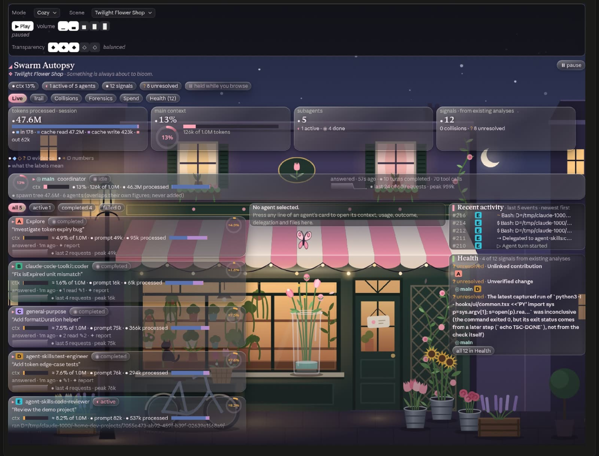

<p align="center">
  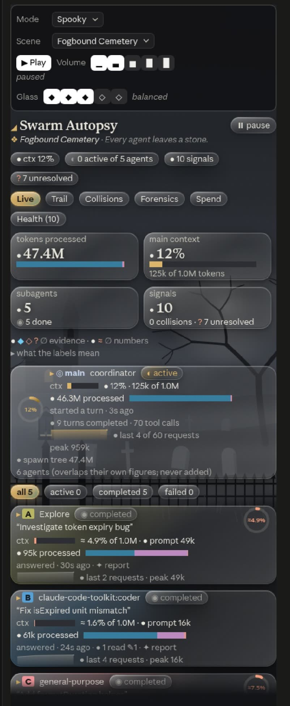
  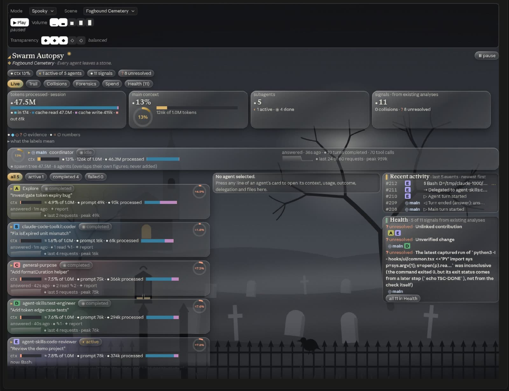
</p>

<p align="center"><i>The default side pane and the expanded pane. Five subagents of five different types (Explore,
general-purpose, a coder, a test engineer and a code reviewer) fixing a bug in a demo project, live.</i></p>

<p align="center">
  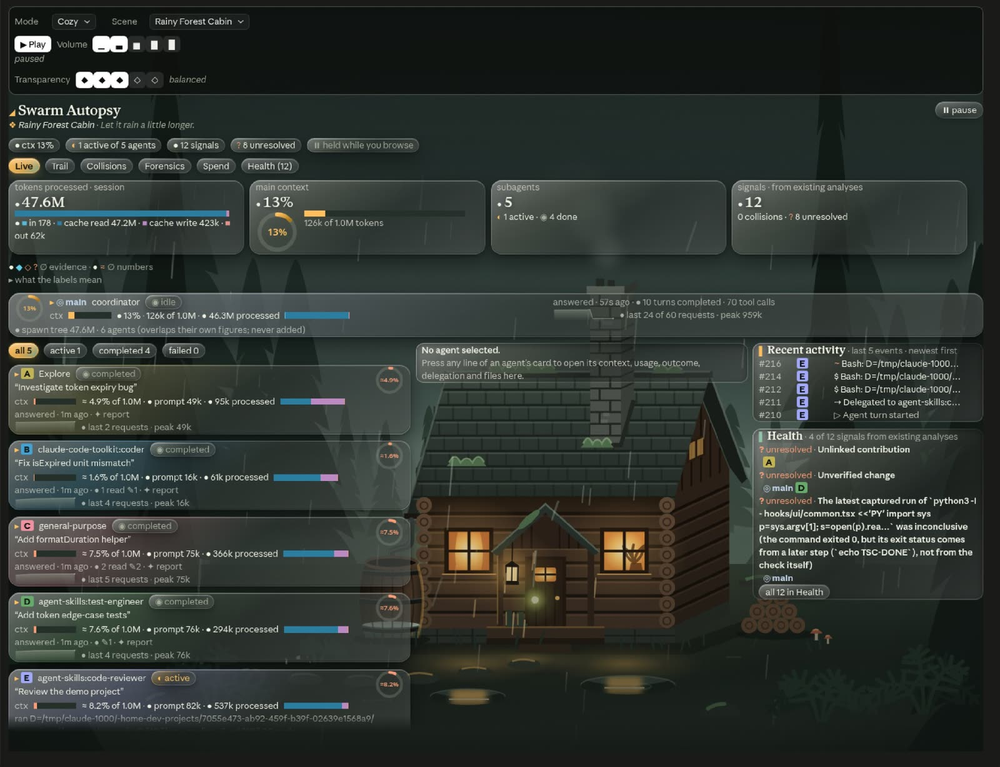
  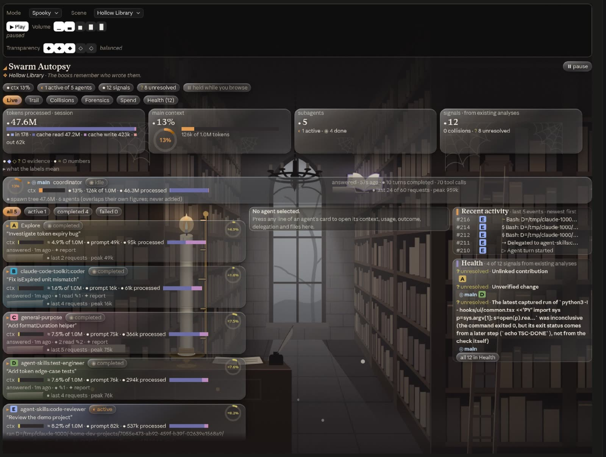
  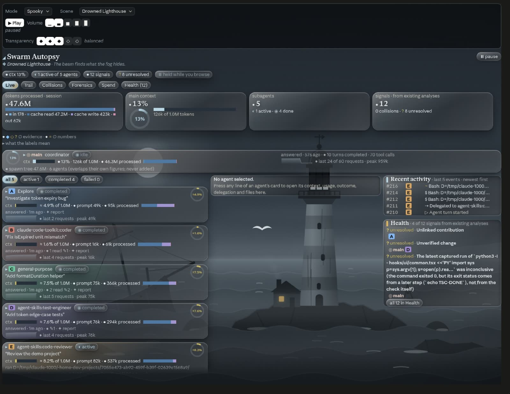
  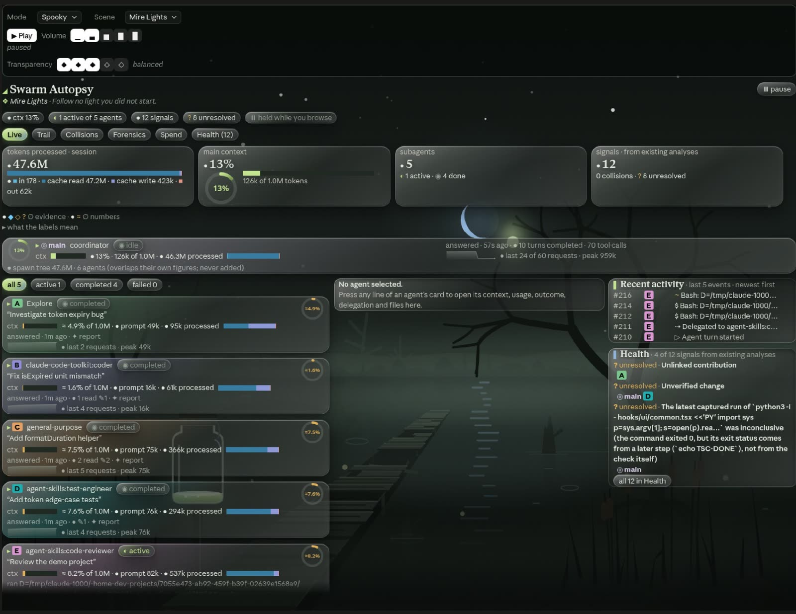
</p>

<p align="center"><i>The same session over Rainy Forest Cabin, Hollow Library, Drowned Lighthouse and Mire Lights.</i></p>

## Why Swarm Autopsy

When a session hands work to subagents, the transcript shows what each one reported back. It does not lay out what
each one did and cost, file by file and request by request, or how its work met everyone else's. Swarm Autopsy records
the session's own events as they happen and turns them into answers you can check.

| | Reading the transcript | With Swarm Autopsy |
| --- | --- | --- |
| A subagent's work | What it reported back | Every tool call it made (delegations as spawns), with its files, command and a result excerpt, each with the hook it came from |
| Did the tests pass? | The agent's own account | The check's own exit status, read step by step |
| Two agents on one file | Pieced together by hand | Seven collision signals, decided by event order |
| Was a report used? | Not shown | A verbatim match or a shared path, labelled by how sure it is |

**Highlights:**
- **Deterministic.** Fixed rules over ids, paths and event order: no model calls, no network.
- **Every claim labelled:** ● OBSERVED, ◆ LINKED, ◇ INFERRED, ? UNRESOLVED or ∅ UNAVAILABLE.
  [The labels →](#reading-the-evidence-labels)
- **`| tail` and `|| true` never count as a pass.** A test passes only when the check itself set the exit status.
  [Test verdicts →](#test-verdicts)
- **Seven collision signals,** across agents and worktrees. [Collisions →](#collisions)
- **A per-request token ledger:** each agent's own requests (*direct*) and its whole spawn tree (*subtree*), in four
  categories. [Spend →](#spend)
- **Read-only and scriptable.** Results pass through unchanged, and the whole session exports as JSON.
  [Export →](#export-and-scripting)

**At a glance:**
- **Runs in:** Claude Code 2.1.287 or later, in the terminal and the desktop app ([requirements](#install)).
- **Records:** live, from the moment the session loads the mod. It can't replay a session that has already happened.
- **Footprint:**
  - TypeScript source, loaded through one entry module (`hooks/register.tsx`);
  - twelve MP3 tracks, about 20 MB;
  - no dependencies and no build step.
- **Licence:** no open-source licence. It is free to install and use; ask before reusing the code
  ([details](#credits-and-licence)).

**Contents:**
- **Get started:** [Install](#install) · [Use it](#use-it) · [Try it in a minute](#try-it-in-a-minute) ·
  [The views](#the-views)
- **The views in depth:** [Evidence labels](#reading-the-evidence-labels) · [Features in depth](#features-in-depth) ·
  [What it does not do](#what-it-deliberately-does-not-do)
- **The look:** [The desktop look](#the-desktop-look) · [All twelve scenes](#all-twelve-scenes)
- **Use the data:** [Export and scripting](#export-and-scripting) · [Configuration](#configuration) · [FAQ](#faq)
- **How it is built:** [Architecture](#architecture) · [Known limitations](#known-limitations) · [Develop](#develop) ·
  [Technical reference](docs/TECHNICAL.md)

## Install

At the prompt of a Claude Code terminal session:

```text
/plugin install swarm-autopsy --marketplace agryu-in/swarm-autopsy-claude-mod
```

Answer `y` to add the marketplace, then press Enter to choose the user scope, so the mod is installed for every project.

From a shell:

```bash
claude plugin install swarm-autopsy --marketplace agryu-in/swarm-autopsy-claude-mod
```

**In the Claude desktop app**, where `/plugin` does not run:
1. Click **+** next to the prompt box, then **Plugins**.
2. Choose **Add marketplace** and enter `agryu-in/swarm-autopsy-claude-mod`.
3. Choose **Add plugin**.

A mod installed from a terminal at the user scope loads in the desktop app's local sessions too. In a chat that was
already open, run `/reload-plugins`.

**Requirements:**
- Claude Code with mods (function hooks): 2.1.287 or later. Tested with Claude Code 2.1.301 (CLI) and 2.1.299 (the
  desktop app's engine). The mod API is early access and may change between releases.
- For the music: macOS, or Linux with PulseAudio or PipeWire (`paplay` and `pactl`). Without either, the pane simply
  says there is no audio player.
- `git` is optional: the Collisions view uses it to resolve worktree roots.

## Use it

| Command | What it does |
| --- | --- |
| `/swarm-autopsy` | Opens the pane: docked beside the transcript, or inline above the prompt in a non-fullscreen terminal |
| `/swarm-autopsy live` | Opens it on a view; also `trail`, `collisions`, `forensics`, `spend` or `health` |
| `/swarm-autopsy export` | Writes the collected session to a JSON file under the session's root and says where |
| `/swarm-autopsy close` | Closes the pane |

In the terminal, `1` to `6` switch views while the pane has the keyboard (`ctrl+x tab`, or a click). Tab walks the
buttons, and Esc hands the keys back. On the desktop, click the tabs.

## Try it in a minute

1. Install it (above), then open Claude Code in a project that has tests.
2. Run `/swarm-autopsy`. The mod records from the moment the session loads it, so the pane can be opened at any time.
3. Give the session work that splits across subagents, for example:

   ```text
   Use three subagents in parallel: one to find where the date helpers are tested,
   one to fix the failing date test, and one to review the fix and run the tests.
   ```

4. Watch **Live** while they run.
5. Then open:
   - **Trail:** did a check pass after each file's last edit?
   - **Collisions:** did the agents touch the same files?
   - **Health:** what is still open?
6. Run `/swarm-autopsy export` to get the whole session as one JSON file.

## The views

| View | Shows |
| --- | --- |
| **Live** | The coordinating session, and one card per subagent: type, parent, task, state, last event, current tool, files, whether a report was captured, its own token usage (and its spawn tree's), and a context gauge. A card opens into its delegated prompt, files, report, context history, token ledger, spend-vs-outcome classification and event history. |
| **Trail** | Per agent, the chain from delegation to verification, and the edges between chains. Each edge carries its evidence and the rule that drew it. On the desktop, a map draws the same graph (solid = LINKED, dashed = INFERRED). |
| **Collisions** | A file × agent matrix (W written, r read, × failed edit), and signals: shared or interleaved writes, one agent replacing text another wrote, writes after a stale read, the same path changed in separate worktrees, edits during a running test, repeated failures, contradictory results. |
| **Forensics** | Every observed event in order, filterable (all / agents / files / tests / failures / signals) and by agent, paged, with the selected event's evidence: source hook, ids, paths, command, diff excerpt, result, and verdict basis. |
| **Spend** | The token ledger: per agent, its own requests (direct) and its whole spawn tree (subtree), with the four token categories kept apart, and session totals. A ≈$ API-equivalent estimate is shown only after you turn it on. Below it, *spend vs outcome*: each agent's tokens grouped by what its work amounted to (verified, changed but unverified, failed or inconclusive, report only, unresolved, mixed), with the denominator stated. |
| **Health** | The findings the other analyses already raised, grouped by source, each with its evidence label, its agents and its events. No score and no traffic light. |

## Reading the evidence labels

| Label | Glyph | Meaning |
| --- | --- | --- |
| OBSERVED | ● | Reported directly by an event, message, command result or tool result. |
| LINKED | ◆ | Connected by explicit identifiers: a spawn's parent, `agentId` on the agent's own events, a verbatim excerpt of one agent's report in another's delegation prompt, a delegation prompt naming the exact path the agent then edited, or an edit replacing text another agent wrote. |
| INFERRED | ◇ | Plausible from indirect evidence: a shared path or file stem plus event order. A candidate, not proof. |
| UNRESOLVED | ? | Not enough evidence to decide: an *unlinked contribution*, an *unverified change*, a latest test run that failed. |
| UNAVAILABLE | ∅ | The interface does not expose it: a subagent's context %, the task of an agent spawned before the mod loaded. |

Numbers carry a simpler label:
- **OBSERVED ●:** read from an event.
- **ESTIMATED ≈:** computed from a stated assumption, such as a ≈$ figure, or a subagent's % on the same model as the
  main session.
- **UNAVAILABLE ∅:** not exposed or not yet captured.

## Features in depth

Each view below gives:
1. what it is for;
2. its main rule;
3. the rest of its details, folded (click to open).

| You want to know | View | Decided by |
| --- | --- | --- |
| Who spawned which agent, and what was it asked? | [Live](#live) | The spawn record |
| Did anything check this file after its last edit? | [Trail](#trail) | A linked check after the file's last write |
| Did that test really pass? | [Test verdicts](#test-verdicts) | The check's own exit status |
| Did two agents edit one file, or overwrite each other? | [Collisions](#collisions) | The writers, in event order |
| Was a subagent's report used? | [Trail](#trail) | Verbatim text or a shared path |
| Which agent used the most tokens, on which model? | [Spend](#spend) | Each request's own usage |
| What share of the tokens went to verified work? | [Spend](#spend) | One outcome bucket per agent |
| How close is each agent to its context limit? | [Live](#live) | The main session's reading, or a labelled estimate |
| What should I look at first? | [Health](#health) | Every finding above, with its evidence |

### Live

**The swarm right now: who is working, on what, and how close each agent is to its limit.**

*Use it to* spot a stuck or failing agent, one near its context limit, or one burning tokens.

**The context gauge:**

| Agent | How it is measured | Label |
| --- | --- | --- |
| Main session | Claude Code's own `session.measure` reading | ● OBSERVED |
| Subagent on the main session's model | Its latest prompt ÷ the main session's window | ≈ ESTIMATED |
| Subagent on another model | Its latest prompt ÷ that model's window, from a [dated table](docs/TECHNICAL.md#context) | ≈ ESTIMATED |
| No usage yet, a model with no known window, or a prompt larger than the window; for the main session, no reading yet | Not shown | ∅ UNAVAILABLE |

Claude Code does not expose a subagent's window to mods, which is why a subagent's figure is always an estimate.

<details>
<summary><b>Cards, state, the inspector and the layout</b></summary>

- **Order.** The coordinator first, then each subagent in order of first sight.
- **Cards.**
  - The first 4 to 12 subagents get full cards; the pane's height sets how many (rows ÷ 8). The rest get one line
    each.
  - The list stops at 40 agents, with "N more agents".
  - The terminal's compact pane (below 56 columns) draws one line per agent.
- **Filters:** all, active, completed, failed.
- **State.**
  - From how the agent's turn ended: an answer is completed, aborted is stopped, and any other end is failed.
  - Or from `SubagentStop`, or from Claude Code's agent list.
- **The task** is the spawn's description, quoted. It is never invented: missing, it reads *task description
  unavailable*.
- **The inspector.** Press any line of a card to open it: the delegated prompt, files, report, context history, token
  ledger, outcome and events.
  - Medium pane: under the card.
  - Wide pane: in a detail column.
  - Compact pane: instead of the list.
  - From 140 columns: three columns (cards, details, and activity with Health).
- **Stable while you read.** A press holds the drawing's data for 20 s, so lines don't move under the pointer.
  **⏸ pause** holds it until you resume.

</details>

### Trail

**From delegation to verification: did each agent's work lead anywhere, and was it checked?**

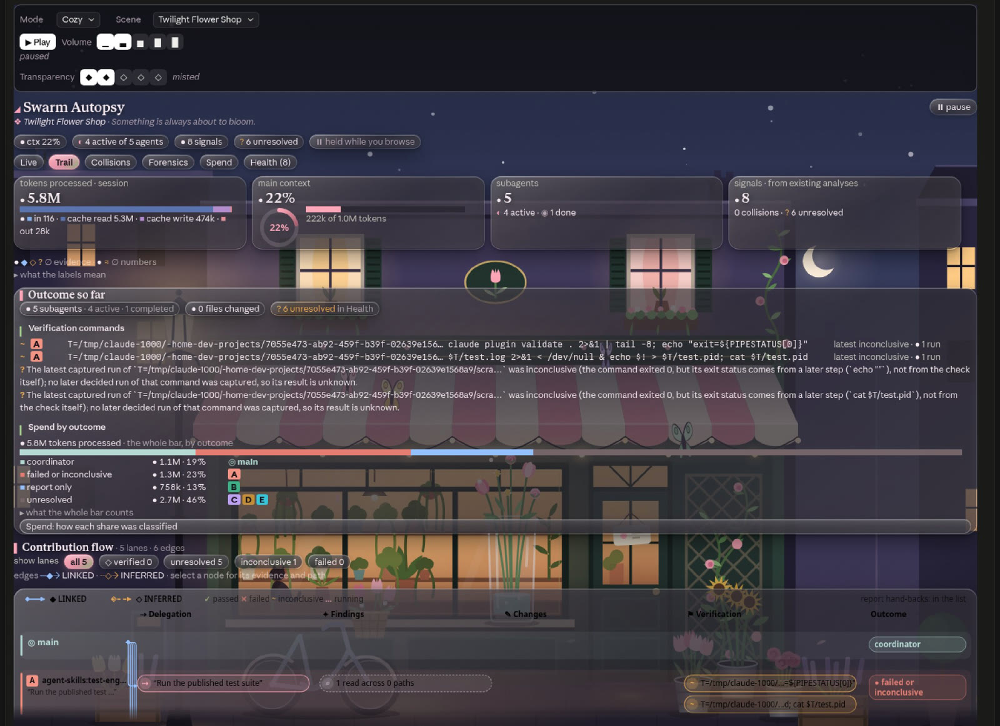

*Use it to* find edits that were never checked after their last change, and see whose reports fed the next step.

**The chain.** Each agent's work moves through five stages:

| Stage | Holds |
| --- | --- |
| 1. delegation | The agent's prompt |
| 2. investigation | Its reads, searches and read-only commands |
| 3. finding | Its report |
| 4. change | Each file it wrote successfully |
| 5. verification | Its test and check runs |

**The edges.** Edges join the chains. Each is drawn by a fixed rule, and carries its label and that rule's basis:

| Edge | Drawn when | Label |
| --- | --- | --- |
| parent → delegation | The spawn record (its parent, or the main session, and its `tool_use_id`), or Claude Code's agent list (a row with no parent is read as the main session), with the agent's task known | ◆ LINKED |
| report → parent | The report came back to the agent's parent | ◆ LINKED |
| report → a later delegation | 12 or more words of the report appear verbatim in the later prompt | ◆ LINKED (7 to 11 words: ◇ INFERRED) |
| report → a later delegation | The report and the later prompt name the same path | ◇ INFERRED |
| report → another agent's later change | The report names the changed file, and that agent could have received it: the author's parent, or an agent spawned after the report (or whose spawn was not seen) | ◇ INFERRED |
| delegation → the agent's own change | Its prompt names the file it then edited | ◆ LINKED by path, ◇ INFERRED by file name |
| change → verification | A passed or failed check after the change, that names the file, was run by the same agent, or names no file and ran in its working tree | ◇ INFERRED |

**A trail, sketched.** This illustrates the rules; it is not a capture:

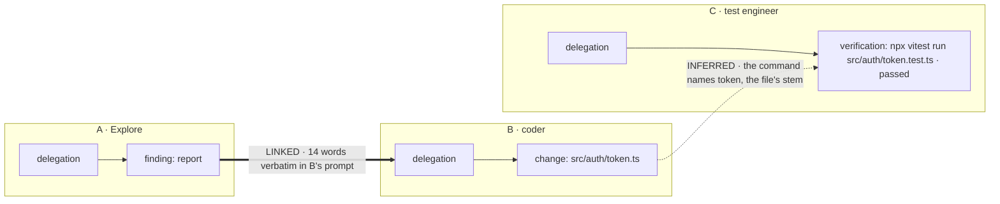

**What stays open (? UNRESOLVED):**
- **An unlinked contribution:** a report that reached nothing captured, from an agent with no change or check of its
  own.
- **An unverified change:** no linked check after the file's last write.
- **A failing or inconclusive check:** a command whose latest run failed or was inconclusive.

<details>
<summary><b>How text and paths are matched</b></summary>

- **Verbatim text** is matched as word 7-grams. A match needs at least 7 words and 40 characters, and the longest run
  wins. It runs on the kept text: the first 2,000 characters of each report and prompt.
- **A briefing the coordinator gave both agents** doesn't count as forwarding: text already in the author's own prompt
  is ignored.
- **Path mentions** in reports and prompts are read with a pattern: directories, then a name with a 1–8 character
  extension.
- **A check names a file** by its path, its file name, or its stem as a whole word. The stem must be 4 or more
  characters, and not a generic one like `index`, `main` or `utils`.
- **Checks.** Only the latest passed or failed run of each command counts, and at most 3 checks per change. A check
  from before the last write is kept, but marked as not covering the final version.
- **Order alone never links anything.**

</details>

### Test verdicts

**A test passes only when the check itself set the exit status.**

A command is split into steps at `&&`, `||`, `|`, `;`, `&` and new lines, with quotes and heredoc bodies blanked out.
Each step is read by the program at its head, never by words inside it. Then:

| Command | Exit | Verdict | Basis, as the pane shows it |
| --- | --- | --- | --- |
| `npx vitest run` | 0 | passed | the tool reported success (no error result) |
| `npx vitest run` | 1 | failed | the tool reported an error: exit code 1 |
| `cd api && pytest -q` | 0 | passed | the tool reported success (no error result) |
| `pytest -q \| tail -5` | 0 | inconclusive | the command exited 0, but its exit status comes from a later step (`tail -5`), not from the check itself |
| `npm test \|\| true` | 0 | inconclusive | the command exited 0, but its exit status comes from a later step (`true`), not from the check itself |
| `npm run build \|\| npm test` | 0 | inconclusive | the command exited 0, but the check runs only when an earlier step fails |
| `npm test &` | 0 | inconclusive | the command exited 0, but the check was sent to the background with & |

- **A leading `cd`.** Trail and Collisions group `cd api && pytest -q` under the `api` directory.
- **Never passed:**
  - refused, interrupted, timed-out and backgrounded runs;
  - a non-zero exit that the tool read as success.

  These are inconclusive, and never failed either.
- **What verifies a change.** Only passed and failed runs are linked to a change, and only a pass verifies it.

<details>
<summary><b>The commands it recognises</b></summary>

| Kind | Heads (an excerpt; also via `npx`, `pnpm exec`, `bunx`, `yarn`) |
| --- | --- |
| Tests | `pytest`, `jest`, `vitest`, `mocha`, `npm test`, `go test`, `cargo test`, `dotnet test`, `node --test`, `make test`, `mvn test`, `gradle test`, `python -m unittest`, `claude plugin test` |
| Checks | `tsc`, `eslint`, `ruff`, `mypy`, `pyright`, `npm run lint` / `build` / `typecheck`, `cargo check` / `clippy`, `go vet`, `claude plugin validate` |

The full list is in [the reference](docs/TECHNICAL.md#tool-calls-tests-and-checks).

</details>

### Collisions

**Where agents got in each other's way.**

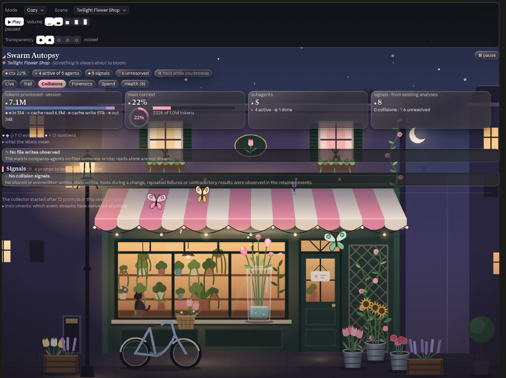

<p align="center"><i>In this session no agent wrote a file, so the matrix is empty and no signal was raised.</i></p>

*Use it to* find the usual reasons a swarm's result doesn't hold together: two agents editing the same code, one
undoing another, or a test run against a moving target.

| Signal | Raised when | Label | Severity |
| --- | --- | --- | --- |
| Shared write | 2 or more agents wrote the file. *Interleaved* when the order returns to an agent (A → B → A) | ● OBSERVED | investigate if interleaved, else notice |
| Overwrite | A later write replaced text a different agent wrote: a whole-file Write, or 12 or more characters of the same text | ● OBSERVED / ◆ LINKED | investigate |
| Stale write | An agent wrote a file it had read, after another agent wrote it in between | ◇ INFERRED | investigate |
| Worktree divergence | The same relative path was written in 2 worktrees of one repository | ● OBSERVED | notice |
| Test during change | Another agent's write landed while a test or check was running | ◇ INFERRED | investigate |
| Repeated failure | A command errored twice or more in one directory, or 2 writes to one path errored | ● OBSERVED | investigate |
| Contradictory results | The same command in the same directory both passed and failed | ● OBSERVED | investigate if the last run failed, else notice |

Signals are decided by the session's own event order, with no clock windows.

**The matrix** has a row per file and a column per agent. An illustration (the note after the row is not part of it):

```text
                          A     B     C
⇄ src/auth/token.ts       W2    W1    r      ← written by A, then B, then A: an interleaved shared write
  src/auth/index.ts       r     W1    ·
  tests/token.test.ts     ·     ×     W1
```

<details>
<summary><b>Matrix cells, caps and worktrees</b></summary>

- **Cells:**
  - `W` is writes, with a count;
  - `r` is read only;
  - `×` is only failed or refused edits;
  - `·` is untouched;
  - `⇄` marks a file that several agents wrote.
- **Caps.** The matrix draws up to 24 files, most writers first, and counts the rest. On a narrow pane some agent
  columns are left out, with a count.
- **Worktree roots.** They come from `git rev-parse --show-toplevel --git-common-dir`, run only for directories that
  were written, with a 5 s timeout. Without git, the matrix still works, but no worktree signal can be raised.

</details>

### Forensics

**Every event, in order, with the evidence behind it.**

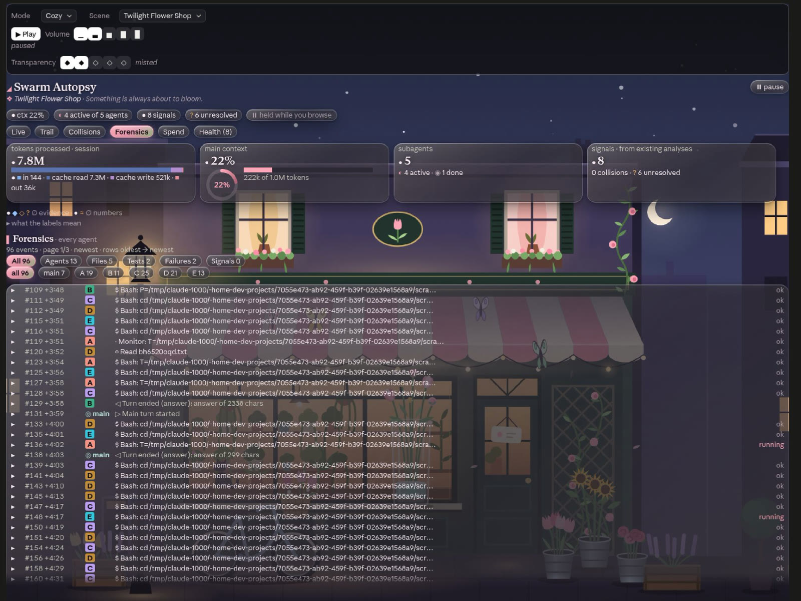

*Use it to* trace any claim in another view back to the exact events it rests on.

**The selected event shows:**
- its source, for example `tool.call: tool_use_id …, agentId …; result captured`;
- its paths and access;
- the command and its kind;
- the diff excerpt;
- the result and the verdict's basis;
- the signals it is part of.

<details>
<summary><b>Filters and paging</b></summary>

- **The timeline** holds the latest 1,200 events, paged to the pane's height, newest page first.
- **Filters:**
  - **agents:** spawns, starts, stops, turn ends, compactions;
  - **files:** reads, writes, searches;
  - **tests:** test and check runs;
  - **failures:** errors, denials, failed verdicts, turns that didn't end in an answer;
  - **signals:** the events a collision signal rests on.
- **An agent filter** sits on top. It starts on the agent focused in Live.

</details>

### Spend

**Where the tokens went, and what they bought.**

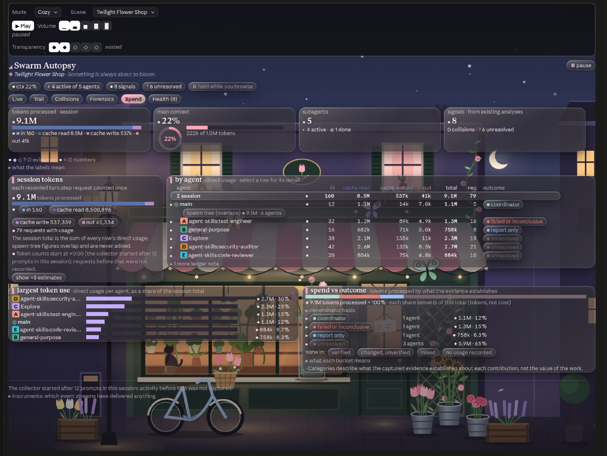

*Use it to* see which agents spent the most, whether the cache did the work, and how much of the session went to
checked work.

**Spend vs outcome** puts each agent's tokens in one bucket:

| Bucket | When |
| --- | --- |
| verified | Each change has a linked check that passed after its last edit, none failed after it, and that command's latest run passed; each check it ran passed last and covers a linked change's final version |
| changed but unverified | A change has no linked check after its last edit |
| failed or inconclusive | A linked check after the last edit failed, that command's latest run failed or was inconclusive, or its own check's latest run did |
| report only | A report, and no change or check |
| unresolved | Nothing decides it (and tokens no agent can be tied to) |
| mixed | More than one of the above |
| coordinator | The main session's own tokens |
| no usage recorded | No request that reported usage |

**The denominator** is stated: the session's tokens processed (input + cache read + cache write + output). Cache
reads usually dominate it, so a share is a share of tokens processed, not of cost.

<details>
<summary><b>The token ledger</b></summary>

- **Source.** Usage comes from each model request as it completes (`turn.step`), in four categories: input, cache
  read, cache write and output.
- **Counted once.** A request is keyed by turn and index, and repeats are set aside and counted. Side requests the
  hook can't see (such as a compaction summary) are not included.
- **Direct and subtree.** **Direct** is an agent's own requests. **Subtree** adds its whole spawn tree.
- **The session total** adds every agent's direct total, so nothing is counted twice. Spawn-tree figures overlap and
  are never added.
- **Cross-check.** Each turn's reported totals are compared with the requests counted, and never added.

</details>

<details>
<summary><b>The ≈$ estimate (opt-in)</b></summary>

- **Off by default.** It stays off until you turn it on in Spend.
- **What it is.** Tokens priced at the dated list prices built into the mod. It is API-equivalent: not a charge, and
  not a subscription's cost.
- **Cache writes.** Usage doesn't say how long a cache write lasts, so the main loop's writes are priced as 1-hour
  (2× input) and subagents' as 5-minute (1.25× input).
- **Missing prices.** A model without a price is named, and the figure reads `≈$X+`.
- **Claude Code's own figure.** When present, it is shown beside the estimate, and never added.
- **Your own prices.** Point `SWARM_AUTOPSY_PRICES` at a JSON file ([format](#configuration)).

</details>

### Health

**One list of what to look at.**

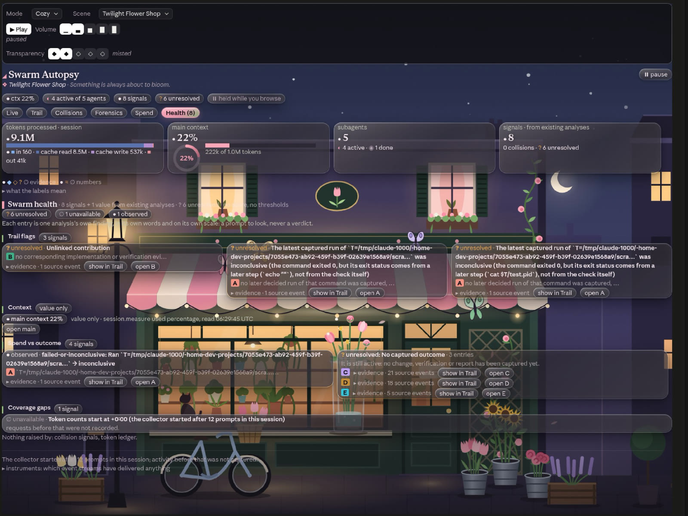

Health gathers what the other analyses already found, in six groups:
1. trail flags;
2. collision signals;
3. context;
4. the token ledger;
5. spend vs outcome;
6. coverage gaps (what the collector could not see).

**Each finding** keeps its source's label, agents and events. It opens its evidence, and can take you to its agent in
Live or its step in Trail.

**No verdict of its own.** Health has no score, threshold or traffic light, and it detects nothing new except the
coverage gaps.

## The desktop look

**The toolbar** is a quiet glass bar fixed at the top of the pane:

| Control | What it does |
| --- | --- |
| **Mode** | The category: Spooky or Cozy |
| **Scene** | The scene within the category |
| **▶ Play / ⏸ Pause** and **Volume** ▁▃▅▇█ | The scene's lofi track |
| **Transparency** ◆◆◆◇◇ | How clear the liquid glass is, from frosted to crystal |

Your choices are kept for every chat. One chat plays the music at a time. When that chat closes, another takes over.

**The background** stays perfectly still while the content scrolls over it. It is drawn for the pane's own shape: a tall
side dock, a normal pane, or a wide one. A view too long for one drawing comes in **parts**, each scrolling smoothly over
the still scene. **Next part ▾** at the bottom of a part moves on.

**The scenes.** Each draws the main session's context fill as part of the picture, and one figure per active subagent:

| Mode | Scene | The context gauge | Each active subagent is |
| --- | --- | --- | --- |
| Spooky | Fogbound Cemetery | a lantern on the gate post, its oil lit | a crow on the fence |
| | Drowned Lighthouse | the lamp room filling with light | a gull |
| | Hollow Library | a candle burning down | a floating book |
| | Crooked Manor | the moon waxing | a bat |
| | Clocktower at Midnight | the clock face filling like a dial | a raven |
| | Mire Lights | a jar of gathered wisp light | a will-o'-wisp |
| Cozy | Rainy Cat Café | a latte filling to the brim | an umbrella passing in the rain |
| | Fireside Tea | the fire in the hearth, burning higher | a candle lit on the mantel |
| | Golden Hour Porch | a jar of honey on the porch rail | a swallow |
| | Sunset Pier | the pier's lanterns, lit one by one | a sailboat on the horizon |
| | Twilight Flower Shop | a glass vase filling as the bouquet opens | a butterfly |
| | Rainy Forest Cabin | a rain barrel by the door | a firefly |

**Colour.** Every colour that carries meaning follows the scene but keeps its meaning: verified stays green, a failure
red, caution warm. Each scene's palette is checked for 4.5:1 text contrast on its glass.

## All twelve scenes

Each scene draws the main session's context as part of the picture (here at 62%) and one figure per active subagent.


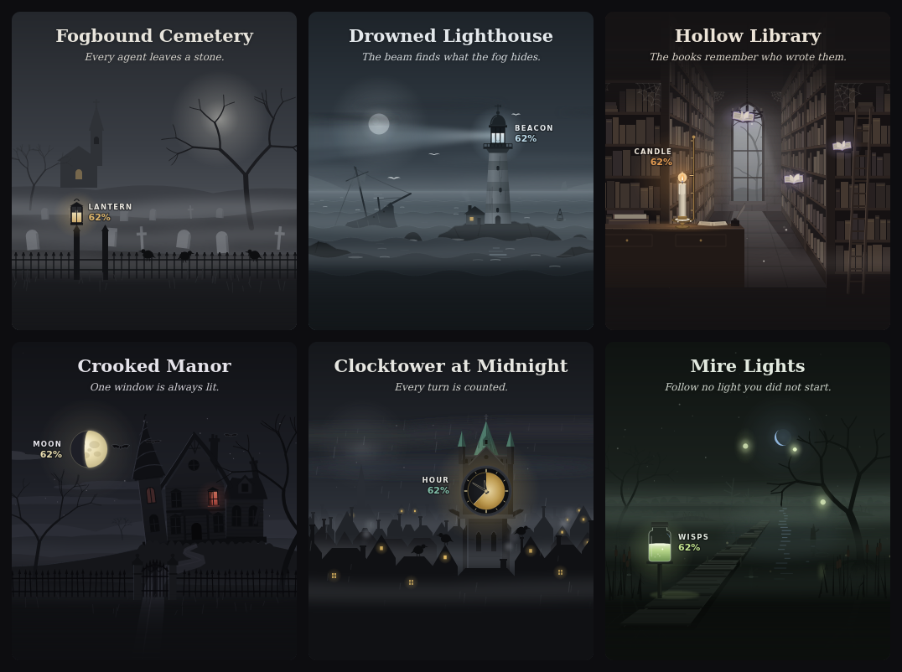

## What it deliberately does not do

- **Model calls:** it never calls a model, so it cannot invent connections. Every link comes from a fixed rule over
  identifiers, paths and event order.
- **Value judgements:** it never calls a contribution "ignored", "unused" or "wasted". It can only say that no
  downstream evidence was captured.
- **Test results:** it never labels a test passed unless the tool's captured result says success.
- **Context %:** it shows one only where a window is known.
- **Your session:** it never blocks, delays or rewrites a tool call, spawn or prompt. Its hooks pass every result
  through unchanged.
- **Privacy:** it has no cloud service, network call or database. The session's record lives in the session and resets
  on `/clear`. Only your scene, music and glass choices are kept across sessions, in the mod's own store. `export`
  writes a file only when you ask.

## Export and scripting

`/swarm-autopsy export` writes the whole record and every analysis to one JSON file,
`swarm-autopsy-export-<time>.json`, in the session's root. An abridged view:

```jsonc
{
  "kind": "swarm-autopsy-export",
  "exportedAt": …,
  "note": "Observed session data and its deterministic analysis; see README for the evidence labels.",
  "snapshot": { "version": 3, "agents": {…}, "events": […], "ledger": {…}, … },
  "analysis": {
    "trail": { "lanes": […], "edges": […], "flags": […], "outcome": {…} },
    "collisions": { "files": […], "totalFiles": …, "agents": […], "signals": […] },
    "ledger": { "rows": […], "session": {…}, "priceTable": {…}, "notes": […] },
    "spend": { "agents": […], "buckets": […], "denominator": …, "denominatorBasis": "…" },
    "health": […],
    "prices": {…}
  }
}
```

**Recipes with `jq`:**

```bash
# Every collision signal: what, how sure, how urgent, which files
jq '.analysis.collisions.signals[] | {kind, evidence, severity, paths}' swarm-autopsy-export-*.json

# Every LINKED edge in the trail, with the rule that drew it
jq '.analysis.trail.edges[] | select(.evidence == "LINKED") | {from, to, basis}' swarm-autopsy-export-*.json

# What is still open: unlinked reports, unverified changes, failing or inconclusive checks
jq '.analysis.trail.flags[] | select(.evidence == "UNRESOLVED") | {kind, agentId, text}' swarm-autopsy-export-*.json

# Every test or check run, its verdict, and why
jq '.snapshot.events[] | select(.tool.verification) | {agentId, command: .tool.command, verdict: .outcome.verdict, basis: .outcome.verdictBasis}' swarm-autopsy-export-*.json

# Tokens per agent (direct), largest first
jq '.analysis.ledger.rows | sort_by(-.direct.processed) | .[] | {label, processed: .direct.processed, requests: .direct.requests}' swarm-autopsy-export-*.json

# Where the tokens went, by outcome
jq '.analysis.spend.buckets[] | {bucket, processed, percent}' swarm-autopsy-export-*.json
```

**Notes:**
- The ≈$ estimates are always included, labelled ESTIMATED.
- An export holds the captured text as it is, without redaction, so treat it like a transcript.
- To export automatically, set `SWARM_AUTOPSY_EXPORT` (see [Configuration](#configuration)).

### The schema

The record is one JSON value. Here is an abridged excerpt of [`types/index.d.ts`](swarm-autopsy/types/index.d.ts):

```ts
type Evidence = 'OBSERVED' | 'LINKED' | 'INFERRED' | 'UNRESOLVED' | 'UNAVAILABLE'

type Snapshot = {
  version: 3
  sessionId?: string
  rev: number                           // bumped by every change; keys the cached analyses
  agents: Record<string, AgentRecord>   // 'main' and every subagent
  agentOrder: string[]
  events: ForensicEvent[]               // the latest 1,200
  droppedEvents: number
  roots: Record<string, string | null>  // directory → git worktree root
  ledger: LedgerState                   // every model request's usage
  context?: ContextReading              // the main session's session.measure reading
  compactionMarks: CompactionMark[]
  notes: string[]
}

type ForensicEvent = {
  seq: number                           // the order every rule uses
  kind: EventKind                       // 'spawn' | 'turn-start' | 'turn-end' | 'tool' | 'agent-stop' | …
  agentId: string
  summary: string
  source: string                        // the hook and the ids it came from
  tool?: ToolFacts                      // access, paths, command, edit excerpt, test or check
  outcome?: ToolOutcome                 // status, exit code, verdict, verdictBasis
}

type AgentRecord = {
  id: string
  label: string                         // 'main', 'A', 'B', …
  type?: string
  description?: string                  // the task, as delegated
  parentId?: string
  parentEvidence: Evidence
  state: 'active' | 'completed' | 'failed' | 'stopped' | 'unknown'
  report?: AgentReport
  counts: { tools: number; reads: number; writes: number; execs: number; errors: number }
}
```

## Configuration

| Variable | Effect |
| --- | --- |
| `SWARM_AUTOPSY_PRICES` | A JSON price table for ≈$, read when the session starts. A bad file is reported, naming the field, and the built-in table is used |
| `SWARM_AUTOPSY_EXPORT` | A path. The export is written there after each main turn and at the session's end |

**A price table:**

```json
{
  "date": "2026-10-06",
  "source": "Where these prices come from",
  "cacheWriteTtl": { "mainLoop": "1h", "subagents": "5m" },
  "models": [
    {
      "model": "claude-sonnet-5-5",
      "inputPerMTok": 2,
      "outputPerMTok": 10,
      "cacheReadPerMTok": 0.2,
      "cacheWritePerMTok": 2.5,
      "cacheWrite1hPerMTok": 4
    }
  ]
}
```

- **Required:**
  - `date`, a real day as YYYY-MM-DD;
  - `source`;
  - `models`, a non-empty list. Each entry gives `model` and the four rates, in USD per million tokens.
- **Optional:**
  - `cacheWrite1hPerMTok` (2× input when left out);
  - `large`, rates for prompts over 100K tokens;
  - `note`, `assumptions` and `cacheWriteTtl`.

All the rules are in [the reference](docs/TECHNICAL.md#prices).

**What it keeps:**

| Where | What | For how long |
| --- | --- | --- |
| Session state, key `snapshot` | The session record | The session; reset on `/clear` or a resume |
| Session state, key `ui` | The tab, filters, selection, parts, the ≈$ switch | The session |
| The mod's store: `mood`, `glass`, `sound`, `music-owner` | Mode and scene, transparency, play and volume, which chat plays | Across sessions |
| `<session root>/swarm-autopsy-export-<time>.json` | An export | Until you delete it |

## FAQ

**Does it slow my session down?**
- **Per event:** the collecting hooks add an in-memory update and pass every result through unchanged. Model responses
  stream straight through.
- **Slower work** (git, the agent list, writing the record) runs on a 250 ms background tick.
- **At the edges:** session start waits for the mod's setup, which includes looking for an audio player. Session end
  waits for the optional export.

**Does it send my code anywhere?** No. It makes no network calls and no model calls.
- **Files.** It writes one only for an export: on command, or to `SWARM_AUTOPSY_EXPORT` if you set it.
- **Captured text** stays in session state, which any mod in the session can read. An export holds it unredacted.

**Can I run it on a session that already happened?** No. It records live, from the moment the session loads the mod.
Agents already running when it loads are adopted, and earlier activity is noted as missed.

**Why does my test say "inconclusive"?** Its captured result can't be read as the check's own pass or fail. It could
be:
- a later step (`| tail`, `|| true`, `; echo`);
- a check that runs only after `||`;
- a background `&`;
- a refusal, an interruption or a timeout;
- a non-zero exit that the tool read as success;
- an error with no exit code.

See [Test verdicts](#test-verdicts).

**Why is a subagent's context marked ≈ or ∅?** Claude Code reports only the main session's window to mods.
- **≈:** estimated from the subagent's latest prompt and a known window.
- **∅:** no usage yet, no known window for its model, or a prompt larger than that window.

**Can it miss things?** Yes, and it says so:
- **In Health:** activity before it loaded, and events past the 1,200 kept, appear as coverage gaps.
- **In Trail:** an agent whose spawn was not seen, and whose parent and task Claude Code's agent list did not supply,
  gets a ∅ flag.
- **In Spend:** requests that came back without usage are counted.

**Does it work in the terminal?** Yes, with the same six views and evidence, in a classic look, with hotkeys 1–6.

**How do I remove it?** Run:

```bash
claude plugin uninstall swarm-autopsy@swarm-autopsy
```

**Found a bug or have an idea?** [Open an issue](https://github.com/agryu-in/swarm-autopsy-claude-mod/issues).

## Architecture

Swarm Autopsy is a Claude Code mod built on the function-hooks API:
- **One module.** It is one TypeScript module, [`hooks/register.tsx`](swarm-autopsy/hooks/register.tsx), which Claude
  Code loads into the session.
- **No build, no dependencies.** It runs as it is. Its only import is the engine's own `claude-code` module, and it
  needs no server.

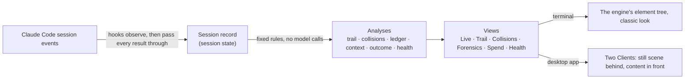

**A hook, end to end.** Every collecting hook wraps the engine's own step and hands its result back untouched:

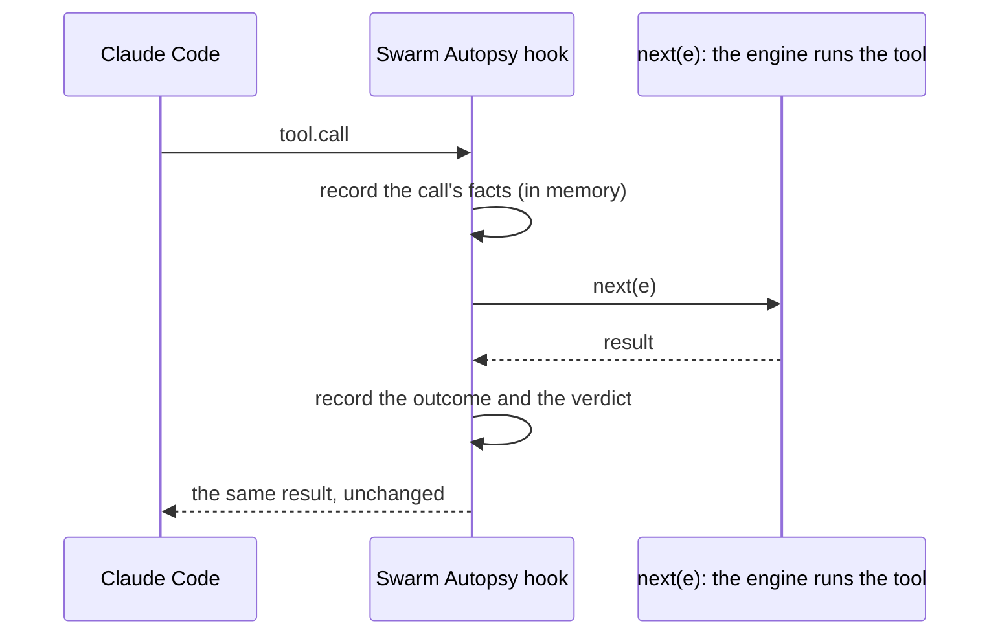

**If the mod fails:**
- The hooks on `agent.spawn`, `tool.call`, the subagent events and `session.compact` carry a `.catch` that passes the
  event on untouched.
- Model responses (`turn.step`) stream straight through.
- A view that fails to draw shows its reason instead of a blank pane.

| Hook | What it gives the mod |
| --- | --- |
| `agent.spawn` | Who spawned whom (parent, `tool_use_id`), the prompt, description, type and the new agent's id |
| `turn.start`, `turn.complete` | Each agent's turns, its report, and how each turn ended |
| `turn.step` | Each model request's usage as it completes: the token ledger's only source |
| `tool.call` | Every tool call the engine raises, except Agent, Task and Workflow (so a subagent's own calls stay visible) |
| `classic.SubagentStart`, `classic.SubagentStop` | Subagents starting and stopping, and their last message |
| `session.compact`, `session.measure` | Compactions; the main session's context reading and Claude Code's cost figure |
| `session.start`, `session.end` | Setup, and a reset on `/clear` or a resume |
| `command.run`, `ui.render`, `ui.message`, `ui.fault` | `/swarm-autopsy`, drawing the pane, presses inside the desktop content, a refused Client |

<details>
<summary><b>Budgets and caps</b></summary>

| What | Value |
| --- | --- |
| Background tick (git, the agent list, record writes) | 250 ms |
| Writing the record to session state | At most once a second on the tick; at once when `/swarm-autopsy` runs, at session start, and after `/clear` or a resume |
| Analyses (trail, collisions, ledger, spend, Health) | Once per revision of the record and ≈$ setting, not per redraw; context gauges are worked out per drawing |
| Hold after a press | 20 s |
| Render budget | 10 s, then the pane draws the reason |
| `git rev-parse` timeout | 5 s |
| Events kept | The latest 1,200; older ones are counted |
| Delegation prompts, reports | 2,000 characters each |
| Commands / tool output / edit excerpts | 400 / 600 / 1,200 per side characters |
| Desktop Client tree | 100,000 characters, 2,000 nodes, depth 32 |

</details>

<details>
<summary><b>Drawing on the terminal and the desktop</b></summary>

**Two terms first:**
- **The engine tree:** Claude Code's own element tree (Box, Text, Button…), which the terminal and the app draw.
- **A Client:** a surface module that the desktop app runs in its page, drawing its own tree.

**How it is drawn:**
- **The layout follows the width:** compact below 56 columns, medium, and wide from 100.
- **On the terminal:** the engine tree in a classic theme, with tabs on hotkeys 1–6.
- **On the desktop:** the pane is exactly the visible height.
  - Behind, a Client ([`scene-client.ts`](swarm-autopsy/hooks/ui/client/scene-client.ts)) draws the still scene.
  - At the top, the toolbar stays fixed, drawn with the app's own controls.
  - In front, a second Client ([`content-client.ts`](swarm-autopsy/hooks/ui/client/content-client.ts)) draws the
    header and the selected tab, scrolling in its own region.
- **Presses.** A press inside the content posts the button's key back through `ui.message`, and the hooks module runs
  that button's own handler.

**Within the page's limits:**
- **`fitPage`** makes every tree fit the desktop page's schema before it leaves, since one refused element blanks the
  whole drawing.
- **Parts.** A view past a Client's bounds comes in parts, with a pager at the list's ends.
- **Fallback.** If the app refuses a Client (`ui.fault`), the pane falls back to the engine tree with a note, then
  retries after 2, 6 and 20 s.
- **Clean strings.** Colour escapes are removed and other control characters become spaces: one stray byte in captured
  output would make the engine refuse the drawing.

</details>

<details>
<summary><b>Scenes and music</b></summary>

**Scenes** are SVG strings built in code ([`hooks/art/`](swarm-autopsy/hooks/art)):
- **Deterministic:** seeded by the scene's id (mulberry32).
- **Animated** with SVG animation, so nothing redraws to move them.
- **Rebuilt,** on the still pane, only when the scene, the pane's size, the context fill or the count of active
  subagents changes. The engine-tree fallback redraws it with the pane.
- **Figures:** one per active subagent, up to 9.
- **Colours** are computed in OKLCH. Tests hold every scene's text to 4.5:1 contrast on its glass.

**Music:**
- **Players.** `paplay` where PulseAudio works, under its own client name, so `pactl` volume changes touch only its
  stream. Otherwise, on macOS, Claude Code's audio player.
- **One chat plays at a time.** The owner renews a heartbeat in the mod's store every 3 s. Another chat takes over 10 s
  after it stops.

</details>

## Known limitations

- Activity before the mod loaded is not captured; the pane says so, and agents still running are adopted.
- Shell commands' file side effects are not attributed to paths. Only Edit, Write, MultiEdit and NotebookEdit count as
  writes.
- The timeline keeps the latest 1,200 events, and older ones are counted as dropped. Agent totals still include them;
  Trail, Collisions and Forensics cover the events kept.
- Path mentions in reports are read with a pattern, so a link from a shared file name is INFERRED, never proof.
- The desktop scenes use the desktop app's drawing surface. Other surfaces draw the classic look.
- **Managed settings.** Where an organization manages Claude Code, the `classic.SubagentStart`,
  `classic.SubagentStop` and `session.compact` hooks run only for plugins its managed settings list (as
  `claude plugin validate` reports).
  - Installed by a person there, the mod still sees spawns, turns, usage and tool calls.
  - It does not see subagent starts and stops, or compactions.
- **Captured text is not redacted.** Captured prompts, reports, commands and output excerpts are kept in session state,
  which Claude Code lets any mod in the session read. An export writes them as they are.
- **A subagent's context % is an estimate.** It is UNAVAILABLE for a model the mod has no window for. That includes a
  model id with a date suffix, unless it is the main session's model.
- **The built-in ≈$ prices are dated** 2026-10-06. For other prices, set `SWARM_AUTOPSY_PRICES`.
- **Long lists are capped** to keep the pane fast:
  - Collisions draws 24 files;
  - Live draws 40 agents before "N more agents";
  - Spend lists 20 rows before a disclosure.

## Develop

The mod lives in `swarm-autopsy/`. Its tests run in Claude Code's own test host:

```bash
claude plugin validate ./swarm-autopsy
```

```bash
claude plugin test ./swarm-autopsy
```

To type-check: load the mod once (for example with `claude --plugin-dir ./swarm-autopsy`), which writes its types into
`swarm-autopsy/.claude-plugin/types/`, then run `npx tsc -p swarm-autopsy`.

### The tests

559 tests in 24 files, run in Claude Code's own test host:

| Files | Cover |
| --- | --- |
| `acceptance` | The whole pane, every tab, both surfaces, several widths; no judging words; a label on every figure |
| `analysis`, `classify`, `reduce`, `signals`, `collector` | Trail and Collisions rules, reading tool calls and commands, the record, Health, the hooks through the host |
| `context`, `ledger`, `outcome` | Context estimates, the token ledger and prices, spend vs outcome |
| `ui-*`, `header-cards` | Each view, the shared kit, scene colours and contrast, the summary cards at every width |
| `client-page`, `page-fit`, `still-*` | The desktop page's rules (`tests/page-rules.ts` mirrors its validator), `fitPage`, parts, fault and retry |
| `art`, `music` | Every scene against the art rules (ids, references, no scripts, size, determinism); the one-player rule |

### The layout

```text
swarm-autopsy/
├── .claude-plugin/plugin.json   the manifest (1.0.0)
├── hooks/hooks.json             names the one module
├── hooks/register.tsx           the hooks, the command, the render hook, the stored settings
├── hooks/music.ts               the music player
├── hooks/lib/                   pure logic: the record, the analyses, tokens, context, prices, scenes, colour
├── hooks/ui/                    the six views and their shared parts
├── hooks/ui/client/             the desktop's two Clients, page fitting, parts and retry
├── hooks/art/                   the SVG kit and the twelve scenes
├── music/                       the twelve tracks and their credits
├── tests/                       the test files and fixtures
└── types/index.d.ts             the record's and the pane's state types
```

### Where things live

| To change | Look in |
| --- | --- |
| What is recorded from each hook | `hooks/register.tsx`, `hooks/lib/collect.ts`, `hooks/lib/reduce.ts` |
| Tool access kinds, test and check heads, verdicts | `hooks/lib/classify.ts`, `hooks/lib/command.ts` |
| Trail edges and verbatim matching | `hooks/lib/trail.ts`, `hooks/lib/excerpt.ts` |
| Collision signals | `hooks/lib/collisions.ts` |
| Token ledger, context, prices | `hooks/lib/ledger.ts`, `hooks/lib/context.ts`, `hooks/lib/pricing.ts` |
| Spend vs outcome, Health | `hooks/lib/outcome.ts`, `hooks/lib/signals.ts` |
| The desktop still pane | `hooks/ui/client/` |

Every rule, threshold, cap and file is in the **[technical reference](docs/TECHNICAL.md)**.

## Credits and licence

- **The code:** © 2026 agryu-in, all rights reserved; it carries no open-source licence. You are welcome to install and
  use the mod. To reuse or change its code elsewhere, ask first.
- **The music:** CC0 lofi by TAD and omfgdude, from [OpenGameArt](https://opengameart.org). Each track's page and author
  are listed in [swarm-autopsy/music/CREDITS.md](swarm-autopsy/music/CREDITS.md). Thank you both.
