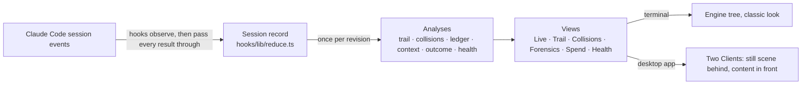

# Swarm Autopsy · technical reference

How Swarm Autopsy 1.0.0 works inside: what it listens to, what it keeps, every rule behind a label, how the pane is
drawn, and what it stores. The [README](../README.md) is the place to start; this page is the detail behind it. Paths are
relative to `swarm-autopsy/`.

- [The mod at a glance](#the-mod-at-a-glance)
- [What it listens to](#what-it-listens-to)
- [The session record](#the-session-record)
- [Agents](#agents)
- [Tool calls, tests and checks](#tool-calls-tests-and-checks)
- [Trail](#trail)
- [Collisions](#collisions)
- [Forensics](#forensics)
- [Tokens](#tokens)
- [Context](#context)
- [Prices](#prices)
- [Spend vs outcome](#spend-vs-outcome)
- [Health](#health)
- [Words it never uses](#words-it-never-uses)
- [Drawing the pane](#drawing-the-pane)
- [The desktop still pane](#the-desktop-still-pane)
- [Scenes, colour and music](#scenes-colour-and-music)
- [What it stores, reads, writes and runs](#what-it-stores-reads-writes-and-runs)
- [Tests](#tests)
- [Files](#files)

## The mod at a glance

- **A function-hooks mod.** `hooks/hooks.json` names one module, `hooks/register.tsx`, which Claude Code loads into the
  session. It is TypeScript and TSX, run as it is: no build step, no npm dependencies, no server.
- **Two surface modules** for the desktop app: `hooks/ui/client/scene-client.ts` (the scene) and
  `hooks/ui/client/content-client.ts` (the content).
- **Engine capabilities it uses:**
  - `$.agent.list`, `$.session.*`;
  - `$.state` (session state) and `$.store` (the mod's own store);
  - `$.clock`, `$.command.register`, `$.ui.*`;
  - `$.env.get`, `$.fs.read` (a price file) and `$.fs.write` (exports);
  - `$.process.run`/`spawn` (git and the music player) and `$.audio.play` (macOS music).
  - `claude plugin validate ./swarm-autopsy` prints the full list.
- **No model calls and no network.** Every result comes from fixed rules over the events, identifiers, paths and event
  order it observed.



## What it listens to

| Hook | What it records |
| --- | --- |
| `session.start` | Registers `/swarm-autopsy`, loads the price file and the stored scene and glass choices, and starts a 250 ms background tick and a 1.5 s music tick |
| `session.end` | Stops the music, writes the env export, and resets the record when the reason is `clear` or `resume` |
| `agent.spawn` | `tool_use_id`, the prompt, description, subagent type, parent agent id, `background`, `cwd`, name, the returned `agentId` and model, or the denial |
| `turn.start` | The turn id, agent id and prompt text |
| `turn.step` | One record per model request, once it has fully arrived: agent, requested and answering model, the four token counts, stop reason. A request that never completes is recorded without usage |
| `turn.complete` | End reason, answer, duration and usage. This usage is only used to cross-check, never added |
| `tool.call` (every tool but `Agent`, `Task` and `Workflow`) | The call's facts at the start and its outcome at the end, for calls the engine raised. The Agent tool is left alone so that a subagent's own tool calls stay visible |
| `classic.SubagentStart` / `classic.SubagentStop` | The agent id and type; on stop, the transcript path (stored, never read) and the last message |
| `session.compact` | Trigger, tokens before and after, and the summariser's usage |
| `session.measure` | The main session's context tokens, window and percent, and Claude Code's cost figure |
| `command.run` | `/swarm-autopsy [live\|trail\|collisions\|forensics\|spend\|health\|export\|close]` |
| `ui.render` | Draws the pane (`component: Pane`, request id `swarm-autopsy`) |
| `ui.message`, `ui.fault` | Presses from inside the desktop content, and a Client the app refused |

**Pass-through.** Every collecting hook returns the engine's own result unchanged:
- a model response streams through as it arrives;
- a tool error is recorded, then rethrown.

The hooks on `agent.spawn`, `tool.call`, the classic subagent events and `session.compact` carry a `.catch` that hands
the event on untouched if the mod's own code fails. The added work per event is an in-memory update. Git lookups, the
agent-list refresh, routine state writes and the per-turn export run on the 250 ms tick, off the session's path. The
writes after a command or a session event, and the export at the session's end, run at once.

## The session record

The record is one `Snapshot` (`types/index.d.ts`). It holds:
- the agents, in order of first sight;
- the timeline of events, each with its `source` (the hook and the ids it came from);
- the token ledger and the context readings;
- compaction marks and Claude Code's cost reading;
- worktree roots and repositories;
- open tool calls, per-hook counters and notes.

**Where it lives.** In session state, under plugin `swarm-autopsy`:
- key `snapshot` holds the record;
- key `ui` holds the pane's state: the tab, filters, selection, the part of each tab and the ≈$ switch.

Session state survives `/reload-plugins`. A stored record is reused only for the same session id. `/clear` or a resume
starts a new one. The record is written at most once a second, and at once after a command or a session event.

**Caps.** They keep the record small and the pane fast:

| What | Kept |
| --- | --- |
| Timeline | The latest 1,200 events; older ones are counted as dropped (agent totals still include them) |
| Delegated prompt, report | 2,000 characters each |
| Command | 400 characters |
| Tool output | 600 characters |
| Edit excerpt | 1,200 characters per side |
| Path mentions per text | 40 |
| Event detail | 300 characters |
| Requests remembered for de-duplication | The last 500 |
| Request history per agent | 40 (the sums stay exact past it) |
| Turns kept for the cross-check | 400 |
| Compaction marks | 60 |

## Agents

- **The main session** is `main`, the coordinator.
- **Subagents** take letters in order of first sight: A to Z, then AA and on.
- **A spawned agent's** id is the `agentId` the spawn returned. Its parent is the spawn's parent agent, or `main`, and
  that link is LINKED, with the spawn's `tool_use_id` as its basis.
- **A spawn that was denied,** or that started no local agent (a remote or workflow run), becomes an event only.
- **An agent seen only through its own events** is still listed. Its parent, type and task are UNAVAILABLE until the
  next tick reads Claude Code's agent list (`$.agent.list`). The list fills the type, task and parent without overriding
  observed ones. A listed status that maps replaces the agent's state whenever the list is read.
- **Agents already running when the mod loads** are adopted from that list. If prompts came before the mod loaded, a
  note says so, and the ledger says when counting began.
- **State.**
  - **A turn's end:** an answer is completed, aborted is stopped, and any other end is failed.
  - **`SubagentStop`:** marks an active or unknown agent completed.
  - **The agent list:** pending, running and waiting are active; idle and completed are completed; failed is failed;
    killed is stopped.
- **The report** is the turn's final answer, or the subagent's hand-back message, or else the last message on
  `SubagentStop`.

## Tool calls, tests and checks

**Access.** Each tool call gets one access kind:

| Access | Tools |
| --- | --- |
| read | `Read`, `NotebookRead`, `LSP` |
| write | `Edit`, `Write`, `MultiEdit`, `NotebookEdit` |
| search | `Glob`, `Grep`, `LS` |
| exec | `Bash`, `PowerShell` |

Paths come from `file_path`, `notebook_path` and `filePath`, plus `path` for searches. Edit excerpts:
- Edit keeps the old and the new text;
- Write and NotebookEdit keep the new text;
- MultiEdit keeps none.

**Tests and checks.**
1. A shell command is split at `||`, `&&`, `|`, `;`, `&` and new lines. Heredoc bodies and quoted text are blanked, and
   leading environment assignments and `time` are dropped.
2. Each segment is read by the command at its head, never by words inside it.
3. A test match wins over a check match.

| Kind | Heads |
| --- | --- |
| Test | `pytest`, `jest`, `vitest`, `mocha`, `ava`, `tap`, `rspec`, `phpunit`, `ctest` (also via `npx`, `bunx`, `pnpm exec`, `yarn`); `npm`/`pnpm`/`yarn`/`bun` `test`; `go test`, `cargo test`/`nextest`, `dotnet test`, `swift test`, `deno test`, `bun test`; `node --test`; `make test`/`check`; `mvn test`; `gradle test`; `python -m pytest`/`unittest`; `claude plugin test` |
| Check | `tsc`, `eslint`, `ruff`, `mypy`, `pyright`, `flake8`, `pylint`, `golangci-lint`, `biome`; `npm`/`pnpm`/`yarn`/`bun` `typecheck`, `lint`, `build`, `check`; `cargo check`/`clippy`/`build`, `go vet`/`build`; `python -m mypy`/`ruff`/`pyright`/`flake8`; `claude plugin validate` |

**Verdict:**
- **passed** only when the tool reported no error and nothing hides the check's exit status;
- **failed** only on an error that carries an exit code;
- **inconclusive** otherwise. The cases are:
  - a refusal, an interruption or a timeout;
  - a run sent to the background, or blocked by a hook;
  - an error with no exit code, or a non-zero exit that the tool itself read as not an error;
  - a command whose exit status is not the check's own: a later step decides it (`| tail`, `|| true`, `; echo`), the
    check runs only after `||`, or it was sent to the background with `&`.

The basis is shown with the verdict. A call that ends without a result is recorded as an error, inconclusive.

## Trail

**Stages.** An agent's chain has five:
1. **delegation:** its prompt, when its parent is LINKED: by the spawn, or by the agent list, which gives no prompt;
2. **investigation:** successful reads and searches, and read-only commands that are not checks;
3. **finding:** its report;
4. **change:** one node per file with at least one successful write. Refused or failed attempts are counted on the
   node but never make one;
5. **verification:** test and check runs.

The main session's lane holds only change and verification.

**Edges:**

| From → to | Requires | Label |
| --- | --- | --- |
| parent → delegation | the spawn record | LINKED |
| finding → parent (hand-back) | the report exists | LINKED |
| finding → another agent's later delegation | a verbatim excerpt of the report inside that prompt | LINKED at 12 words or more, INFERRED below |
| finding → another agent's later delegation | otherwise, the report and the prompt name the same path (equal, or one a `/`-suffix of the other) | INFERRED |
| finding → another agent's later change | the report names the changed path or its file name, and the editor could have received it (the author's parent, or an agent spawned after the report or with no observed spawn) | INFERRED ("a shared name is not proof the report caused it") |
| delegation → the same agent's change | the prompt names the file | LINKED by path, INFERRED by file name alone |
| change → verification | a decided (passed or failed) run after the change (see below) | INFERRED |

**Verbatim excerpts:**
- Text is normalised: the characters `` ` * _ " ' `` are stripped, and edge punctuation is trimmed from each word. Case
  is kept.
- It is indexed as word 7-grams.
- A match needs at least 7 words and 40 characters; the longest run wins.
- Runs that also appear in the author's own prompt are excluded, so text the coordinator gave both agents is not taken
  for forwarding.
- Matching runs on the kept text (2,000 characters of each report and prompt), so text past that never links.

**Path mentions** are read with a pattern: an optional `./`, `../` or `/`, directories, then a name with a 1–8 character
extension that starts with a letter. Abbreviations such as `e.g` and anything beside `://` are skipped. A text yields
at most 40 paths.

**Change → verification:**
1. Only the latest decided run per command and directory counts, and at most 3 checks per change.
2. The first basis that holds is used:
   - the command names the file, by path, by file name, or by its stem as a whole word. The stem must be at least 4
     characters and not a generic one such as `index`, `main`, `test`, `utils`, `types` or `config`;
   - the same agent ran it;
   - it names no file and ran inside the file's working tree (its git worktree's top level, or below).
3. A check before the file's last write is kept, but its basis says it does not cover the final version.

The directory is the agent's, or a leading `cd <dir> &&`.

**What becomes UNRESOLVED:**
- an **unlinked contribution:** a report with no change or check of its own, and no edge from it to another agent's
  work;
- an **unverified change:** no linked check after the file's last write;
- a command whose **latest run failed** or was **inconclusive**.

A missing delegation or report (once the agent's end was observed) is UNAVAILABLE instead.

Order alone never links anything. On the desktop a map draws the same graph: solid for LINKED, dashed for INFERRED.

## Collisions

**The matrix** has files as rows and agents as columns. Its cells:
- `W` and a count for successful writes (`+` past 9), amber when the file has more than one writer;
- `×` for only failed or refused edits;
- `r` for read only;
- `·` for untouched.

Rows are files with a write or a failed write, most writers first, then the most recent:
- the analysis keeps 40;
- the matrix draws 24 and says how many more were written;
- on a narrow pane some agent columns are left out, with a count.

Signal cards show 8 first, and up to 40 behind **show more**.

**Signals.** All ordering is by the session's event sequence. There are no clock windows.

| Signal | Raised when | Label | Severity |
| --- | --- | --- | --- |
| Shared write | 2 or more agents wrote the file successfully. *Interleaved* when the writers' order returns to an agent (A → B → A), otherwise *sequential* | OBSERVED | investigate if interleaved, notice if sequential |
| Overwrite | a later write on a shared file replaces text written by the last different agent: a whole-file `Write`, or one excerpt containing the other (at least 12 characters) | OBSERVED for `Write`, LINKED for an excerpt | investigate |
| Stale write | an agent writes a file it last read, after another agent wrote it in between | INFERRED | investigate |
| Worktree divergence | the same relative path is written under 2 or more worktree roots of one repository ("not a physical conflict") | OBSERVED | notice |
| Test during change | another agent's successful write lands between a test or check's start and end | INFERRED | investigate |
| Repeated failure | a command errors 2 or more times in one directory (refusals excluded), or 2 or more write attempts on one path error | OBSERVED | investigate |
| Contradictory results | the same command in the same directory has both passed and failed | OBSERVED | investigate if the last decided run failed, notice otherwise |

**Worktree roots** come from `git -C <dir> rev-parse --path-format=absolute --show-toplevel --git-common-dir`, with a 5 s
timeout. Lookups run only for directories that had a successful write. Without git:
- the root is unknown, and rows show the path (relative to the session's directory when inside it);
- no divergence is raised;
- the trail's same-working-tree rule cannot apply.

Separate repositories are never grouped. Signals marked *investigate* are listed before *notice*. "A signal is a prompt
to look, never a verdict."

## Forensics

**Filters:**

| Filter | Shows |
| --- | --- |
| all | every event |
| agents | spawns, denied spawns, agent starts and stops, turn ends, roster updates, compactions, subagent turn starts |
| files | reads, writes and searches |
| tests | tests and checks |
| failures | denied spawns, errors and denials, failed verdicts, turns that did not end in an answer |
| signals | the events a collision signal rests on |

An agent filter applies on top. It starts on the agent focused in Live, if any.

**Pages** are `max(6, rows − 22)` events long. Page 1 is the newest; events within a page run oldest to newest. Events
past the 1,200 kept are counted as dropped (∅).

**The selected event's evidence:**
- its kind, agent and times;
- the **source**, e.g. `tool.call: tool_use_id …, agentId …; result captured`;
- the paths and access;
- the command and its test or check kind, with the exit-status note;
- the diff (`−old` / `+new`);
- the result status and the verdict's basis;
- the output;
- the signals it is part of.

A call still running reads "result not captured yet".

## Tokens

- **Source.** The ledger's only source is `turn.step`, one record per model request. It reads `input_tokens`,
  `output_tokens`, `cache_read_input_tokens`, `cache_creation_input_tokens` and the model. A missing or bad count reads
  as 0.
- **The four categories:** input, cache read, cache write and output. **Processed** is their sum. **Prompt size**
  (input + cache read + cache write) is read per request.
- **Attribution.** A request goes to its step's agent id. One with no agent id goes to `main` (the main loop). An id
  never seen as an agent keeps its own UNRESOLVED row and is not folded into main.
- **Per model:** the answering model, else the requested one, else "unknown model".
- **Counted once.** A request is keyed by turn and index. A repeat only increments a duplicates count, and its tokens
  are set aside.
- **Direct and subtree.** **Direct** is an agent's own requests. **Subtree** adds every agent in its spawn tree (built
  from parents, safe against cycles). The **session total** adds every row's direct total, never a subtree, so nothing
  is counted twice. Spawn-tree figures are drawn as overlapping and never added.
- **Cross-check.** Each `turn.complete` total is compared with the requests counted for that turn: compared, differ, or
  reported only.
- **Largest token use** ranks agents by direct tokens as a share of the session total: the top 10, then "+N more".
- **The ledger table,** on a wide pane, shows in / cache read / cache write / out / total / requests, with a Σ session
  row first. Narrower panes show the total, a bar and the requests. It draws up to 20 rows, then a disclosure.
- **An agent's detail** shows:
  - its attribution and basis;
  - its exact counts and models;
  - its stop reasons;
  - the cross-check;
  - its last 8 requests (5 on a compact pane).

## Context

- **The main session.** Its window and percent are Claude Code's own `session.measure` reading, OBSERVED; the mod does
  not compute them. Before the first reading both are UNAVAILABLE. When a reading has a window but no fill (a fresh
  or just-compacted window), the window stays OBSERVED and the % is UNAVAILABLE.
- **A subagent.** Claude Code does not expose a subagent's context window to mods, so its % is an estimate (ESTIMATED):
  - its latest prompt over the main session's window, when its model is exactly the main session's model and that
    window was read on that model;
  - otherwise its latest prompt over a dated table of documented windows (`hooks/lib/context.ts`, 2026-10-06). A `[1m]`
    model suffix means 1M; a provider prefix is stripped.
  - It is UNAVAILABLE when the model is unknown, not in the table, or the prompt is larger than the window. Unlike
    prices, the window lookup does not remove a `-YYYYMMDD` suffix, so a dated model id shows UNAVAILABLE.
- **History.**
  - 40 requests per agent;
  - the inspector's chart draws up to 40 points, a card's sparkline up to 24;
  - the peak prompt is exact over every request.
- **Stop reasons** are counted per agent. `max_tokens`, `model_context_window_exceeded` and `compaction` are marked as
  context-related; `refusal` is not. Compactions are marked on the history.
- **Colour** follows the label, not the fill: OBSERVED is a solid ring in the context colour, ESTIMATED a dashed ring
  in the caution colour, UNAVAILABLE a muted "∅ % n/a".

## Prices

**The ≈$ figure is off by default.** The **show ≈$ estimates** button in Spend turns it on for that chat.
- With it off, no cost is computed or drawn.
- Exports always include the estimates, labelled ESTIMATED.

**The built-in table:**
- It is dated 2026-10-06 and holds first-party API list prices, USD per million tokens, for the current models
  (`hooks/lib/pricing.ts`).
- A cache write costs 1.25× input at the 5-minute lifetime and 2× at the 1-hour lifetime. Usage does not say which, so
  the main loop is priced as 1-hour and subagents as 5-minute (what every recorded session showed).
- Models are matched exactly, after a `[…]` suffix and then a `-YYYYMMDD` suffix are removed. Provider-prefixed ids
  stay unpriced.
- A model with `large` rates prices its requests over 100K prompt tokens at those rates.

**Unpriced models:**
- their tokens stay in every total and are left out of ≈$;
- the model is named, and the figure reads `≈$X+`, or "∅ no price" when nothing is priced.

**What the figure is, and is not.** It is an API-equivalent estimate: not a charge, and not what a subscription costs.
Fast mode is not visible to the mod. Claude Code's own cost reading, when present, is shown beside it as OBSERVED and
never added to it.

**Your own table.** Point `SWARM_AUTOPSY_PRICES` at a JSON file:

```json
{
  "date": "2026-10-06",
  "source": "Where these prices come from",
  "assumptions": ["Optional notes, up to 12"],
  "cacheWriteTtl": { "mainLoop": "1h", "subagents": "5m" },
  "models": [
    {
      "model": "claude-sonnet-5-5",
      "inputPerMTok": 2,
      "outputPerMTok": 10,
      "cacheReadPerMTok": 0.2,
      "cacheWritePerMTok": 2.5,
      "cacheWrite1hPerMTok": 4,
      "note": "optional"
    }
  ]
}
```

The rules for the file:
- `date` must be a real day, and `source` is required;
- each model has the four rates;
- `cacheWrite1hPerMTok` is optional (2× input when left out);
- an optional `large` object holds tier rates;
- rates run from 0 to 10,000, with at most 200 models.

More rules:
- `models` must be a non-empty list with no id twice. A model id has at most 100 characters (letters, digits and
  `. _ - : @ / [ ]`).
- `source` has at most 300 characters, each assumption 400, and a `note` 200.

The file is read when the session starts, so after an edit start a new session or reload the mod. A bad file is
reported in Spend, naming the field, and the built-in table is used. It is never silently replaced.

## Spend vs outcome

**Each change** is classified:

| Class | When |
| --- | --- |
| verified | every linked check after the file's last write passed, and its command's latest run did not fail or end inconclusive |
| changed, unverified | no linked check yet, or every linked check came before the last edit (also while an edit has no result yet) |
| failed or inconclusive | a linked check after the last edit failed, or its command's latest run failed or was inconclusive; or, with no linked check, the agent's own latest run after its last edit was inconclusive |

**Other contributions:**
- **An agent's own checks,** grouped by command and directory:
  - latest run still running: unresolved;
  - latest run failed or inconclusive: failed or inconclusive (OBSERVED);
  - latest run passed and covers a linked change's final version: verified;
  - latest run passed but covers no linked change: unresolved.
- A report counts only when the agent made no change and ran no check. It is **report only**, with its edge's label, or
  UNRESOLVED if nothing linked it.
- An agent with nothing captured is unresolved: UNRESOLVED while active, UNAVAILABLE after.

**Each agent's tokens go to one bucket:**
- its one class;
- **mixed** when it has more than one;
- **unresolved** when it has none;
- **coordinator** for the main session;
- **no usage recorded** when no request that reported usage was recorded.

Tokens no agent can be tied to also go to unresolved.

**The denominator** is stated: the session's tokens processed, all four categories over every request. "Unverified
means not shown either way, not broken."

## Health

Health adds no score or threshold, and detects nothing new except the coverage gaps. It gathers six sources, in order:
1. trail flags;
2. collision signals;
3. context;
4. token ledger;
5. spend vs outcome (only the unverified, failed or inconclusive, mixed and unresolved buckets);
6. coverage gaps (what the collector could not see).

Each entry keeps its source's label or severity, its agents and its events. Each group shows 5 entries first, up to 30.
There is no score, threshold or traffic light; a test forbids the words "score", "health" and "critical" in its
entries.

## Words it never uses

- **No judging words.** Tests scan every line of every tab, on both surfaces. No line may say "wasted", "useless",
  "lost", "ignored", "unused", "inefficient", "more than expected" or "top contributors".
- **Every figure carries a label.** Tests check that every token, request or % figure has an evidence glyph on its line
  (● ≈ ∅ ◆ ◇ ?). This runs on the terminal at 49 and 116 columns, and on the desktop at 116.
- **"passed" means passed.** Tests on the analysis hold that a run is passed only where the captured result says
  success. Refused or blocked runs are inconclusive, never failed, and never passed.
- **Order alone links nothing.** Tests on the analysis hold that a report and a change are never linked by order
  alone.

## Drawing the pane

**When it redraws:**
- The pane redraws when the session record or its own state changes. The record is written at most once a second.
- Analyses are computed once per revision of the record, and per ≈$ setting.
- **Held while you browse.** A press holds the drawing's data and clock for 20 s, so the line you are about to press
  does not move and every press finds its handler. **⏸ pause** holds it until you press **▶ live**.

**Size.**
- **Width** is the pane's columns, at least 30.
- **Height** is its visible rows, or 40 when not given.
- **Layouts:** compact below 56 columns, medium from 56, wide from 100. The Live view spreads to three columns from
  140.

**The Live view.**
- **Cards.** It draws full cards for 4 to 12 agents (by the pane's height, rows ÷ 8), then one line per agent; after
  40, "N more agents". The terminal's compact pane draws one line per agent; the desktop draws cards at every width.
- **The inspector** opens under the card (medium), in a detail column (wide), or in place of the list (compact).
- **Recent activity** shows the last 5 events.

**Every drawn string is cleaned.** ANSI escapes are removed, other control characters become spaces, and a lone
surrogate (half an emoji) becomes �. Numbers, colours and picture sizes are bounded. One bad character in captured output would otherwise make the engine refuse the
whole drawing.

**When drawing fails:**
- **A view throws:** the pane says which view could not be drawn and why, and offers Live and Health. The collector
  keeps running.
- **The render hook throws, or runs past its 10 s budget:** the pane draws the reason and how to retry
  (`/swarm-autopsy close`, then `/swarm-autopsy`). The engine's empty "Nothing to show yet" never appears.

**The terminal** draws the engine tree in the classic theme, with no scene and no toolbar. Tabs carry hotkeys 1–6, and
a **wider** button asks for 120 columns.

## The desktop still pane

On the desktop the pane is exactly the visible rows tall and never scrolls itself. It holds:
- **The scene Client** (`sa-scene`), behind, as a still layer.
- **The toolbar** (Mode, Scene, music, Transparency), drawn with the app's own controls and fixed at the top.
- **The content Client** (`sa-content`), in front, for the header and the selected tab. It scrolls inside its own
  region, `max(4, rows − toolbar)` rows tall:
  - it draws no scrollbar, and a soft fade at its foot shows there is more;
  - a hidden keeper element holds the scroll position across redraws, and resets it on a new tab or part.

**Presses.** The views are drawn as an ordinary tree, then turned into plain data. Each button's handler stays in the
hooks module, indexed by its key. A press inside the Client posts `{press: key, nth}` back, and the `ui.message` hook
runs that button's own handler.

**The page's limits, and how the mod keeps to them:**
- **Size.** A Client's tree may have at most 100,000 characters, 2,000 nodes (elements and text strings) and depth 32.
  - The props are sent as a flat table, so they stay within the engine's nesting limit.
  - The drawn tree's depth is still measured against 32.
- **Schema.** `fitPage` (`hooks/ui/client/shape.ts`) makes every tree fit the page's schema before it leaves, since one
  refused element makes the page refuse the whole tree. It:
  - drops element types the page does not draw;
  - drops props that are not plain values;
  - gives a picture an alt and scales it within 4,096 px (a source over 131,072 characters becomes its alt text);
  - gives a key outside 1–256 characters a stable hashed stand-in;
  - turns a label into text.
- **Styles.** The page drops a whole style that trips its filter, so tests hold every raw style the content Client
  writes, on every tab and width, to `styleIsSafe`, a mirror of that filter. It blocks:
  - `url(`, `image(`, `image-set(`, `src(`, `element(`, `expression(`, `-moz-binding` and `behavior:`;
  - backslashes, `<`, and `@` outside at-rules;
  - anything over 4,000 characters.

**Parts.** A view too large for one Client comes in parts (`hooks/ui/client/parts.ts`):
1. **The list is found** by going down through any child holding at least 60% of its parent, to where children share
   the size. A run of keyed siblings (cards, lanes) also stops it.
2. **Its items are packed** in order into the budget left after the rest of the tree. An item too long alone is split
   inside it, up to 5 levels deep.
3. **Every part keeps** the header, the tabs and the summary. A pager sits at the list's ends: **▴ Previous part**,
   **Part N of M**, **Next part ▾**.
4. **Each tab remembers its part.**
5. **The chosen part is measured again** on the very tree that is drawn. Tighter splits (92%, 78%, 64%, 50% of the
   budget) are tried until it fits.

**Fallback and retry:**
- If the app refuses a Client (`ui.fault`), or a view cannot be drawn in a Client, the pane draws the engine tree, with
  a dim line saying why ("still scene unavailable: …"). The scene is then a frame that follows scrolling.
- A fault retries with a fresh pair of Clients after 2 s, 6 s and 20 s, three times at most. After that the line says to
  reopen the pane, and `/swarm-autopsy` starts over.

## Scenes, colour and music

**Scenes** are plain SVG strings built in code (`hooks/art/`). They have no images, no scripts and no external
references.
- **Deterministic.** Each scene is seeded by its id (mulberry32), so it draws the same every time.
- **Motion** is SVG animation (`<animate>`, `<animateTransform>`), repeating forever, with negative start times so a
  scene loads mid-motion. Nothing is redrawn to animate.
- **Shape.** The scene is rebuilt only when its inputs change: the pane's size in pixels (estimated at 8.5 px a column
  and 20 px a row, capped at 4,096), the main session's context fill, and the count of active subagents. A wide window
  shows more of the sides; a tall dock adds sky above and ground below.
- **Layers.** A surround (stars, mist or motes, and ground fog), the painting, and a veil over the header and card
  bands. On the page it sits over a full-size gradient wash.
- **What the picture shows.** The context gauge is drawn into the picture (for example, the cemetery lantern's oil and
  glow). One figure is drawn per active subagent, up to 9.

**Colour** is worked out in OKLCH (`hooks/lib/color.ts`, `hooks/lib/themes.ts`):
- Each status keeps its hue family (verified green, failure red, caution warm). It is pulled toward the scene's key hue,
  its chroma is capped to the scene's mood, and its lightness is set for the glass.
- Agent identities are eight hues 45° apart, at two alternating lightnesses. Token categories have their own fixed
  hues. Every colour is eased into sRGB.
- Tests hold every scene's text to 4.5:1 contrast on its glass, marks to 3:1, and every set of colours to a minimum
  perceptual distance.
- **Transparency** has five steps (default 3). They set the glass's fill, blur and text shadow.

**Music:**
- **The tracks.** There is one track per scene in `music/`: mono MP3, 96 kbps, 44.1 kHz, about −23 LUFS (credits in
  `music/CREDITS.md`).
- **Where PulseAudio works** (`pactl info` and `paplay --version` both succeed, normally Linux): `paplay` plays it,
  with client name `swarm-autopsy-music`.
  - A volume change finds that stream through `pactl` and sets it, so no other app's sound is touched.
  - The track loops by restarting. Three quick failures in a row turn the player off.
- **Otherwise, on macOS:** the engine's `$.audio.play`, looping, at 1.4× the step's gain.
- **Anywhere else:** once Play is pressed, the toolbar says why there is no audio (for example, that `paplay` is not
  installed).
- **One chat plays at a time.** The owner is stored as `music-owner` in the mod's store. It renews a heartbeat every
  3 s, and each chat checks every 1.5 s. A heartbeat older than 10 s lets another chat take over, and a chat that ends
  releases the music.
- **Volume** has five steps: 14%, 24%, 36%, 52% and 72% of full volume for `paplay` (default: step 2, 24%).

## What it stores, reads, writes and runs

| Where | What | Kept |
| --- | --- | --- |
| Session state, `swarm-autopsy/snapshot` | The session record, including captured text (prompts, reports, commands, outputs and edit excerpts, within the caps) | For the session. Any mod in the session can read it; only Swarm Autopsy writes it |
| Session state, `swarm-autopsy/ui` | The pane's state (tab, filters, selection, parts, ≈$ switch) | For the session |
| The mod's store: `mood`, `glass`, `sound`, `music-owner` | Mode and scene, transparency, play and volume, the music's owner | Across sessions, in a JSON file of the mod's own under Claude Code's configuration directory |
| `<session root>/swarm-autopsy-export-<time>.json` | Written by `/swarm-autopsy export` | Until you delete it |

**Exports.**
- An export is `{kind: "swarm-autopsy-export", exportedAt, note, snapshot, analysis}`. The analysis holds the trail,
  collisions, ledger, spend, health and prices, with ≈$ always included.
- It holds the record as captured, without redaction, so treat it like a transcript.
- To export automatically, set `SWARM_AUTOPSY_EXPORT` to a path: the same file is written there after each main turn
  and at the session's end.

**Reads.**
- The only file the mod reads itself is the `SWARM_AUTOPSY_PRICES` file, and only if you set it.
- The music player plays the mod's own tracks from `music/`.
- A subagent's transcript path is stored as text and never read.

**Runs:**
- `git rev-parse` in directories that had a write;
- for music, `uname -s`, `pactl` and `paplay`.

It makes no network calls.

## Tests

559 tests in 24 files, run in Claude Code's own test host (`claude plugin test ./swarm-autopsy`). On 2026-10-20 all 559
passed on Claude Code 2.1.303.

| Files | Cover |
| --- | --- |
| `acceptance` | The whole pane, every tab, both surfaces, several widths; judging words; labels on every metric |
| `analysis`, `classify`, `reduce`, `signals`, `collector` | The trail, collisions, reading tool calls and commands, the record, Health, and the hooks through the host |
| `context`, `ledger`, `outcome` | Context, the token ledger and prices, spend vs outcome |
| `ui-live`, `ui-trail`, `ui-spend`, `ui-forensics`, `ui-collisions-health`, `ui-foundation` | One view each, and the shared kit |
| `ui-theme`, `header-cards` | Scene colours, contrast and distance, the classic terminal, the stored mood; the summary cards and spacing at every width |
| `music` | The one-player rule, tracks and credits, play, pause and volume, the player's arguments |
| `art` | Every scene: unique ids, resolving references, no script or external link, under 131,072 characters, deterministic, figures stop at 9 |
| `client-page`, `page-fit`, `still-parts`, `still-big`, `still-fault` | The desktop page's rules on every tab and width (a mirror of the page's validator in `tests/page-rules.ts`), `fitPage`, parts and the pager, fault and retry |

## Files

```text
swarm-autopsy/
├── .claude-plugin/plugin.json   the mod's manifest (name, version 1.0.0)
├── hooks/
│   ├── hooks.json               names the one module
│   ├── register.tsx             hooks, the command, the render hook, the ticks, the stored settings
│   ├── music.ts                 the music player: detection, paplay, $.audio, the one-player tick
│   ├── lib/                     pure logic, no drawing
│   │   ├── collect.ts, reduce.ts, classify.ts, command.ts   events into the session record; tool calls and commands
│   │   ├── trail.ts, excerpt.ts, collisions.ts, timeline.ts the Trail, verbatim matching, Collisions, Forensics
│   │   ├── ledger.ts, tokens.ts, pricing.ts, context.ts      tokens, ≈$, context
│   │   ├── outcome.ts, signals.ts                           spend vs outcome, Health
│   │   ├── scenes.ts, themes.ts, color.ts, palette.ts       scenes, palettes, OKLCH colour, roles
│   │   └── clarity.ts, music.ts, format.ts                  transparency steps, the one-player rule, number formats
│   ├── ui/                      the views, as an engine tree
│   │   ├── pane.tsx, common.tsx, kit.tsx, glass.tsx          shell, tabs, shared parts, toolbar and glass
│   │   ├── live*.tsx, trail*.tsx, trail-model.ts, trailmap.ts, collisions.tsx, forensics.tsx, events.tsx,
│   │   │   spend*.tsx, ledger.tsx, outcome.tsx, health*.tsx, context.tsx     one view each
│   │   ├── bars.tsx, press.tsx, svg.ts                        bars, press targets (a card line), desktop vector marks
│   │   ├── clean.ts, failed.tsx                              string cleaning, the failure pane
│   │   └── client/                                           the desktop still pane: two Clients, fitPage, parts, retry
│   └── art/                     kit.ts (SVG primitives), scene.ts (registry), background.ts (pane-shaped scene), scenes/ (12)
├── music/                       12 MP3 tracks and CREDITS.md
├── tests/                       24 test files and their fixtures
└── types/index.d.ts             the record's and the pane's state types
```
